(section-installation-03-install-vortexros-1)=
# 从 Live ISO 安装

<span id="overview"></span>

用 Live ISO 将 VortexROS 离线安装到本地磁盘。安装期间需要可用的串口或显示器和键盘。安装会擦除所选目标盘。已经运行 VortexROS 的设备请使用[升级与回退](07-upgrade-uninstall.md)。

<span id="principles"></span>

(section-installation-03-install-vortexros-2)=
## 工作原理

设备固件从 U 盘或虚拟光驱启动 Live 系统。安装器验证签名并把系统和启动文件写入目标盘，再根据向导选择生成初始配置。下次启动从目标盘加载已安装系统。安装介质拔除后，登录、网络配置和签名升级都在已安装系统内操作。

<span id="examples"></span>

(section-installation-03-install-vortexros-3)=
## 配置与验证

(case-conditions-installation-03-install-vortexros)=
### 1. 准备介质和独立控制台

备份目标盘上的数据，记录目标盘的型号和容量。使用随制品提供的 SHA-256 核对 ISO。Linux 可执行 `sha256sum ISO文件名`，Windows PowerShell 可执行 `Get-FileHash ISO文件名 -Algorithm SHA256`。摘要一致后，将 ISO 以磁盘映像写入 U 盘，或在虚拟机中挂载原 ISO。写 U 盘时确认选中的是安装介质。安装开始前确认能操作设备的串口，或已连接显示器和键盘。

下图的 GRUB 菜单来自实机。其余界面图取自 r4 安装串口记录，保留实际终端文字，省略重复重绘。磁盘名、CPU 与网卡编号以本机为准。

(section-installation-03-install-vortexros-4)=
### 2. 在 GRUB 选择安装终端

通过串口安装时选 `VortexROS Live (serial)`。接显示器和键盘时选 `VortexROS Live (local display)`。安装介质的菜单默认等约 10 秒。进入后应看到查找介质、验证签名和加载系统的提示，随后出现安装向导。

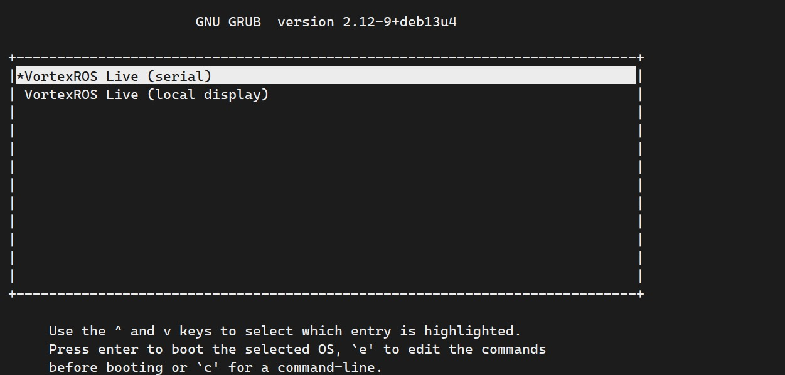

(section-installation-03-install-vortexros-5)=
### 3. 选择目标盘

对照 `/dev/disk/by-id/` 下的持久标识和容量，输入目标盘序号。示例中只有一块 4.0 GiB 的虚拟测试盘。设备有多块容量相同的磁盘时，先比对持久标识再继续。此处完成选择，最终的擦盘确认在后面。

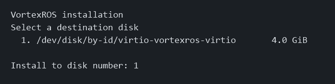

(section-installation-03-install-vortexros-6)=
### 4. 设置管理员密码

输入并重复输入账户 `vortexros` 的管理员密码。使用 8–256 字节，且与账户名不同。录入时密码不回显。按错误提示重填当前字段即可，安装结束后用此密码登录目标盘系统。

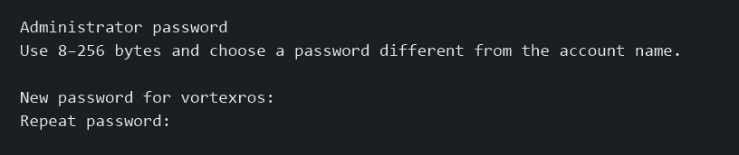

(section-installation-03-install-vortexros-7)=
### 5. 选择是否保留串口登录

查看检测到的安装终端。本例为 `ttyS0`、115200 baud。以后通过串口管理或救援时选择 `Y`，并记录终端号和速率。方括号或默认值提示可用回车接受。使用显示器安装时，按实际维护方式决定是否启用已安装系统的串口登录。

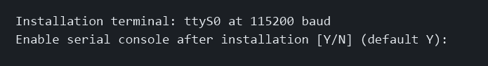

(section-installation-03-install-vortexros-8)=
### 6. 核对硬件拓扑

先查看在线 CPU、插槽、核心、NUMA 内存与网卡的 PCI 地址、驱动和 IOMMU 组。系统启动时关闭 SMT，因此只从在线 CPU 选择主核与工作核。用 PCI 地址和当前检测到的 Linux 接口判断实际接线，尤其要区分管理口与业务口。

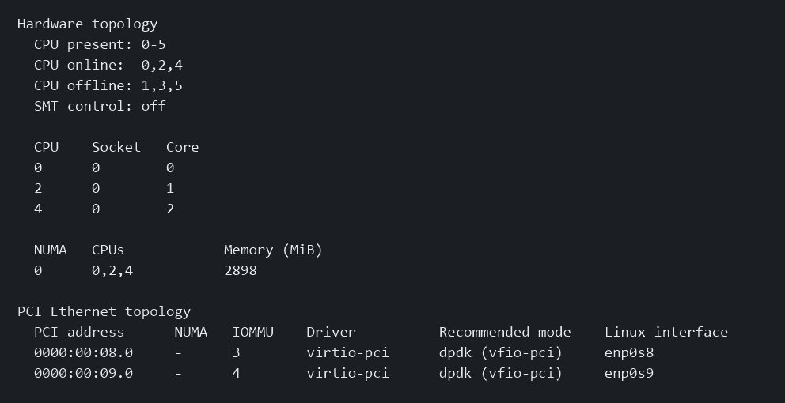

(section-installation-03-install-vortexros-9)=
### 7. 选择网卡模式和队列

首次使用或只需先接通管理网络时，可在 `Configure dataplane interfaces now` 选择 `N`，保留 Linux 管理网卡。现在就配置 DPDK 时选择 `Y`。同类网卡使用同一组参数时选择批量设置，有单独管理口或设备能力不同时逐口设置。

| 项目 | 如何选择 |
| --- | --- |
| `kernel/dpdk` | `kernel` 由 Linux 驱动管理，`dpdk` 将受支持的接口交给 VPP。本例两块兼容 Virtio 口都选用 DPDK。 |
| RX/TX queue count | 从设备建议值开始。提高队列数前核对网卡能力和工作核数量。 |
| RX/TX descriptors | 优先采用设备建议值。描述符影响队列能容纳的报文和内存开销。示例为一组经验证的虚拟机参数。 |

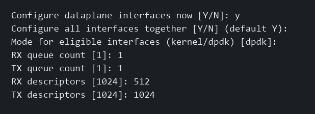

(section-installation-03-install-vortexros-10)=
### 8. 设置 CPU、大页和 IOMMU

确认 PCI 地址和 `Ethernet` 名称对应正确。主核处理 VPP 主线程，工作核处理报文，使用不同在线 CPU。CPU 隔离会在目标系统启动时生效。大页按数据面 NUMA 节点预留，本例 512 个 2 MiB 页占用 1 GiB。设置前确认各 NUMA 节点的可用内存，尤其是小内存设备。给 VFIO 接管网卡时保留 IOMMU 打开，并确认固件启用了相应的 IOMMU 功能。

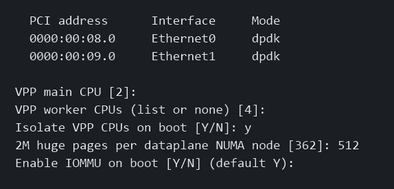

(section-installation-03-install-vortexros-11)=
### 9. 核对并确认擦盘

查看验签后的 `Target disk` 和 `System image`。只有设备标识、版本和备份都正确时才确认。这里回车等同 `Y`。需要退出或重新检查时输入 `N`。

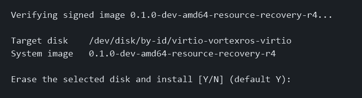

(section-installation-03-install-vortexros-12)=
### 10. 拔除安装介质并首次登录

看到 `Installed` 和 `Remove the installation medium` 后，拔出实体 U 盘，或在虚拟机管理界面移除光驱或虚拟 U 盘，再按 Enter 重启。此时应从目标盘进入已安装系统的 GRUB，默认约 3 秒后启动。

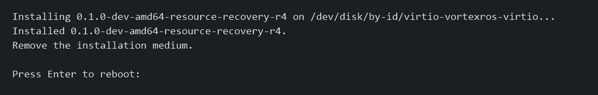

看到 `VortexROS login:` 后，输入 `vortexros` 和安装时设置的密码。登录成功可见产品提示符。

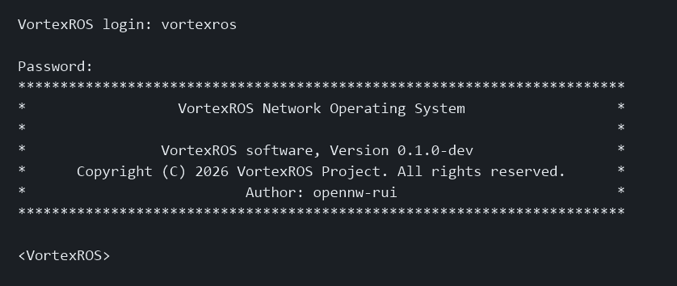

(case-verification-installation-03-install-vortexros)=
### 11. 验证安装

执行 `display startup`，确认运行、默认和下次启动都指向刚安装的版本。空盘首次安装时 `Backup system software` 为 `NULL`。下图及文本为 r4 启动后实际回显。

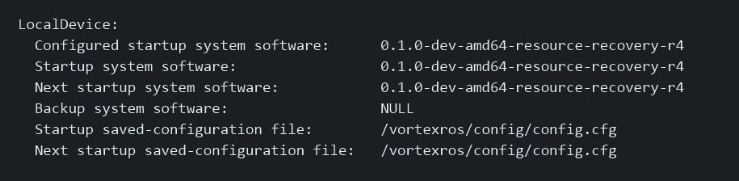

```text
<VortexROS> display startup
LocalDevice:
  Configured startup system software:      0.1.0-dev-amd64-resource-recovery-r4
  Startup system software:                 0.1.0-dev-amd64-resource-recovery-r4
  Next startup system software:            0.1.0-dev-amd64-resource-recovery-r4
  Backup system software:                  NULL
  Startup saved-configuration file:        /vortexros/config/config.cfg
  Next startup saved-configuration file:   /vortexros/config/config.cfg
```

再执行 `display interface brief`。本例接管两个 Virtio 口后的实测节选如下。选择 Linux 模式的接口会显示实际驱动类型。未接线的口可能保持 down。

```text
<VortexROS> display interface brief
Interface               PHY    Proto   InUti  OutUti  CRC    Type      MTU
Ethernet0               up     up       0.0%    0.0%   --    DPDK      1500
Ethernet1               up     up       0.0%    0.0%   --    DPDK      1500
```

[首次启动](06-first-start.md) · [配置数据面](05-vpp-startup.md)

(local-display-installation)=
### 用本地显示器安装的界面对照

下面是 r4 虚拟机的实际屏幕，从 UEFI 虚拟 U 盘离线安装到 SATA 盘。该虚拟机没有接入网卡，因此向导显示未检测到 PCI 网卡，并跳过网卡与数据面配置。实际设备有网卡时，按上方第 6–8 步核对和选择。

1. 在 GRUB 用方向键选中 `VortexROS Live (local display)`，按 Enter。向导会在显示器上列出目标盘。

   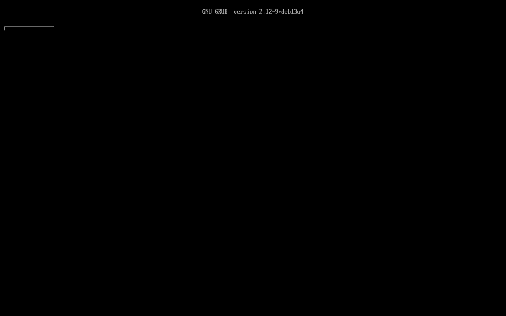

   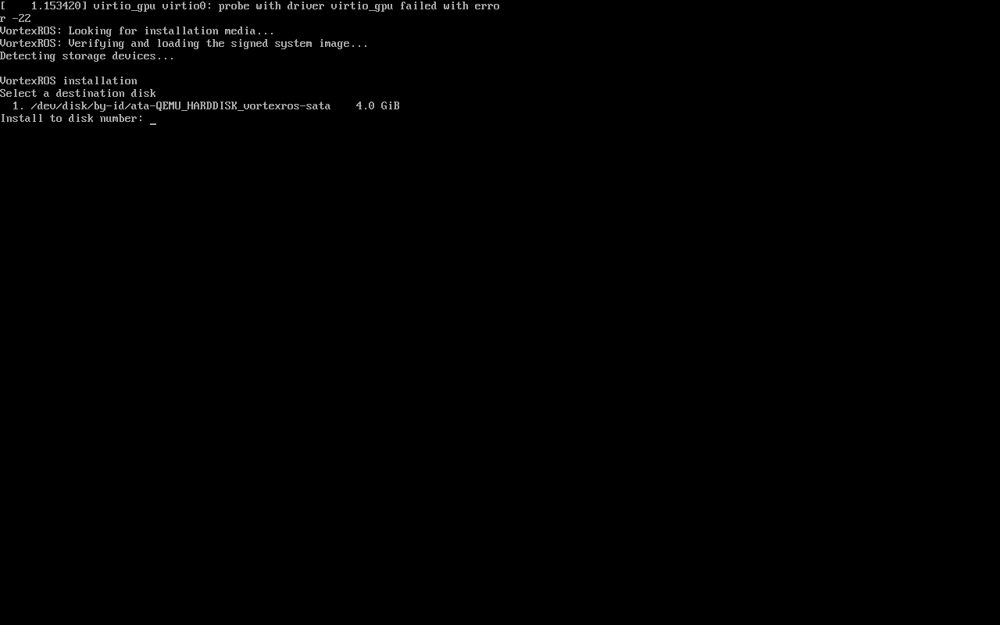

2. 选盘后设置管理员密码，再按维护方式决定是否启用串口。本例使用本地键盘和显示器，接受关闭串口登录的默认值。

   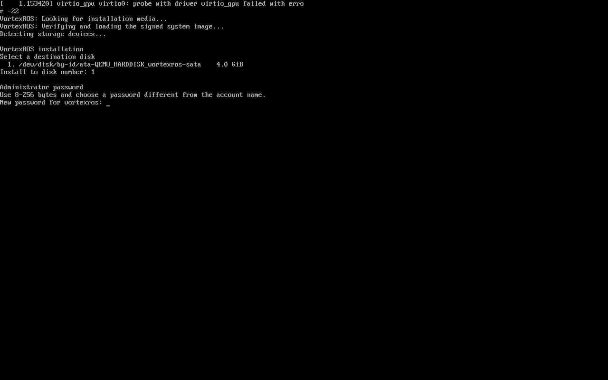

   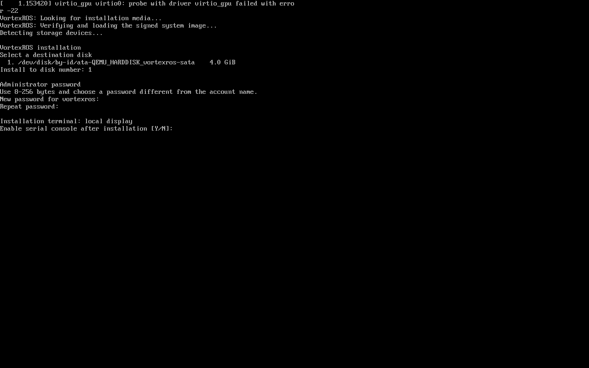

3. 核对磁盘和镜像，确认写盘。看到移除介质提示后，先拔掉 U 盘，再按 Enter 重启。

   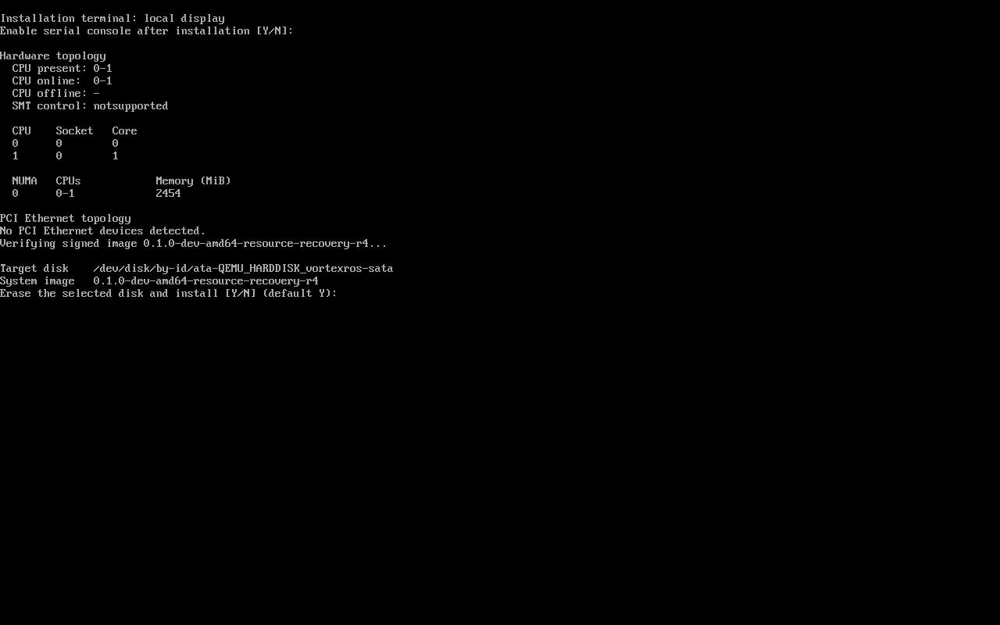

   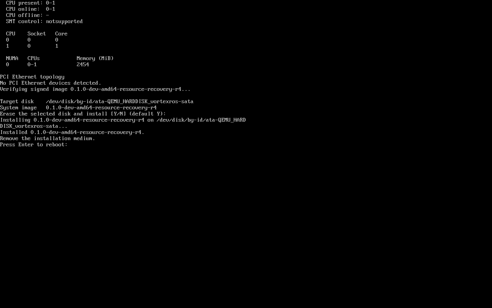

4. 从目标盘启动后在 tty1 登录，看到 `<VortexROS>` 后再按第 11 步核对版本和接口。

   

   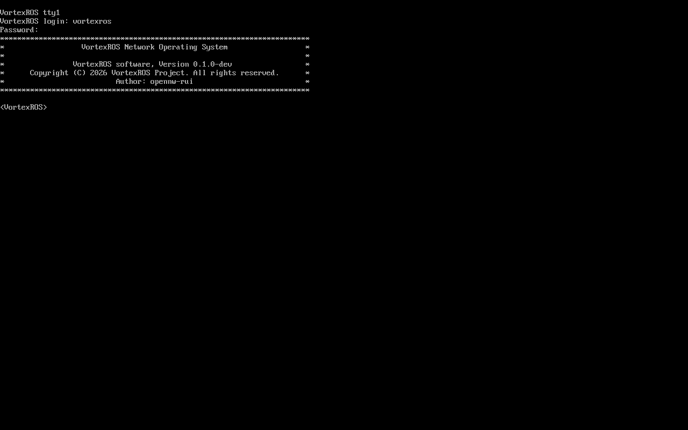

<span id="precautions"></span>

(section-installation-03-install-vortexros-13)=
## 注意事项

- 进入 CLI 后默认镜像还未显示时，等待本次镜像确认事件，再重新查询 `display startup`。用 `display logbuffer service image` 查看本次启动记录。
- 若再次进入 Live 菜单，检查是否已经移除安装介质，以及固件是否优先从目标盘启动。
- 若串口切换到目标盘后无提示，核对安装时是否启用串口、接线、端口号和波特率。也可到本地显示器确认设备是否已启动。

<p data-legacy-id="id1" class="manual-previous-section" data-section-moved><a href="#overview">介绍</a></p>
<p data-legacy-id="id2" class="manual-previous-section" data-section-moved><a href="#case-conditions-installation-03-install-vortexros">安装准备</a></p>
<p data-legacy-id="id3" class="manual-previous-section" data-section-moved><a href="#examples">配置案例</a></p>
<p data-legacy-id="id4" class="manual-previous-section" data-section-moved><a href="#case-verification-installation-03-install-vortexros">验证安装</a></p>
