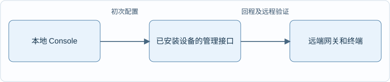

# 快速入门：首次启动与管理接入 配置案例

## 拓扑



(case-conditions-installation-06-first-start)=
## 配置条件

从系统盘启动后，在 Console 用安装时设置的 `vortexros` 账户和密码登录。先核对启动镜像、保存配置和已加载接口。

```text
<VortexROS> display version
<VortexROS> display startup
<VortexROS> display interface brief
<VortexROS> display ip interface brief
<VortexROS> display current-configuration
```

## 配置步骤

示例使用 Ethernet0 连接管理网络，网关为 192.0.2.1。请替换为实际接口、地址和网关。从 Console 进入系统视图并录入下列配置，最后提交。

```vortexros-config
interface Ethernet 0
 ip address 192.0.2.2 255.255.255.0
#
ip route-static 0.0.0.0 0.0.0.0 192.0.2.1
#
return
```

(case-verification-installation-06-first-start)=
## 验证方法

对照以下命令和预期结果核对设备状态。

```vortexros-cli
display ip interface brief
display ip routing-table protocol static
ping 192.0.2.1
```

核对 Ethernet0 的地址和状态，再确认路由表中有默认路由且网关能应答。需要远程管理时，按 [STelnet 与 VTY](../../operator/02-system-services/stelnet.md) 配置并实际登录验证。通过后执行 `save`。首次恢复出厂或以空配置启动时，按 Console 提示更改初始口令。

[配置与保存](../../operator/01-cli.md) · [AAA、SSH 与 VTY](../../operator/02-system-services.md)
