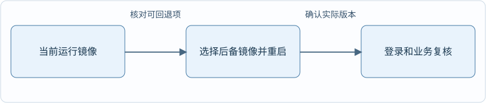

(section-installation-software-rollback-1)=
# 回退与删除系统镜像

<span id="overview"></span>

需要恢复到先前软件时，可选择已确认的镜像作为下次启动目标。可以清理未被当前启动、下次启动或后备槽引用的镜像。

<span id="principles"></span>

(section-installation-software-rollback-2)=
## 工作原理

系统有一个后备槽。新镜像试启动并确认后，原默认镜像进入后备槽。此前占用后备槽的镜像仍列在 `display system-software`，可显式选择启动，也可在不再使用时手动清理。

<span id="examples"></span>

(section-installation-software-rollback-3)=
## 配置与验证

(section-installation-software-rollback-4)=
### 操作流程



(case-conditions-installation-software-rollback)=
### 配置条件

安排维护窗口并保存当前配置，准备可用的 Console。若 `Backup system software` 为 `NULL`，表示当前没有后备镜像。

(section-installation-software-rollback-5)=
### 配置步骤

```vortexros-cli
display system-software
startup system-software backup
display startup
```

确认回退目标后执行 `reboot`。若选择另一份可用的已确认镜像，使用 `startup system-software installed IMAGE-ID`。核对角色后，可用 `delete system-software IMAGE-ID` 删除不再使用的镜像。

(case-verification-installation-software-rollback)=
### 验证方法

对照以下命令和预期结果核对设备状态。

```vortexros-cli
display version
display startup
display system-software
display health
```

确认设备运行目标版本并加载预期的业务配置。重新测试管理登录、关键协议邻居和业务流量；删除镜像后从清单核对结果。

<span id="observed"></span>

(section-installation-software-rollback-6)=
### 健康检查失败自动回退的实测回显

r4 试启动时控制层启动失败。设备自动重启并回到已确认的 r3，r3 恢复双栈转发和原管理员登录。回退试启动的日志及随后设备的启动状态如下。

```text
<VortexROS> display logbuffer service image
18:34:10.029+00:00 INFO image/recover SERVICE_MESSAGE -- Starting vortexros-image-recover.service - Return to the confirmed VortexROS system image...
```

```text
<VortexROS> display startup
LocalDevice:
  Configured startup system software:      0.1.0-dev-amd64-resource-recovery-r3
  Startup system software:                 0.1.0-dev-amd64-resource-recovery-r3
  Next startup system software:            0.1.0-dev-amd64-resource-recovery-r3
  Backup system software:                  NULL
  Startup saved-configuration file:        /vortexros/config/config.cfg
  Next startup saved-configuration file:   /vortexros/config/config.cfg
```

<span id="precautions"></span>

(section-installation-software-rollback-7)=
## 注意事项

运行中、默认、后备及待启动镜像均不可直接删除。回退后核对业务配置和管理会话。

<p data-legacy-id="id2" class="manual-previous-section" data-section-moved><a href="#overview">介绍</a></p>
<p data-legacy-id="id3" class="manual-previous-section" data-section-moved><a href="#case-conditions-installation-software-rollback">配置准备</a></p>
<p data-legacy-id="id4" class="manual-previous-section" data-section-moved><a href="#examples">配置案例</a></p>
<p data-legacy-id="id5" class="manual-previous-section" data-section-moved><a href="#case-verification-installation-software-rollback">验证配置</a></p>
