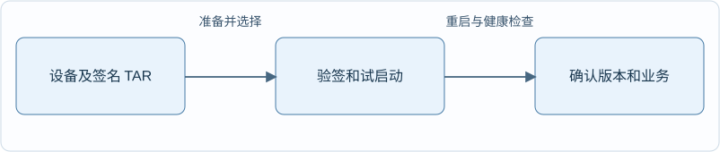

(section-installation-software-upgrade-1)=
# 签名镜像升级

<span id="overview"></span>

设备可以在维护窗口试启动一份签名镜像。确认成功后，新镜像成为默认启动镜像，上一份确认镜像会保留为后备。

<span id="principles"></span>

(section-installation-software-upgrade-2)=
## 工作原理

签名 TAR 可用于试启动。确认后更新默认镜像，并保留已确认的后备镜像。

<span id="examples"></span>

(section-installation-software-upgrade-3)=
## 配置与验证

(section-installation-software-upgrade-4)=
### 操作流程



(case-conditions-installation-software-upgrade)=
### 配置条件

准备与设备架构相符的签名 TAR 和独立 Console。保存已生效的配置，将 TAR 放入 `/vortexros/install/`。下列 `IMAGE.tar` 应替换为实际文件名，可用问号和 Tab 补齐。

(section-installation-software-upgrade-5)=
### 配置步骤

```vortexros-cli
save
check system-software IMAGE.tar
startup system-software IMAGE.tar
display system-software operation
display startup
```

在准备作业完成、确认下次启动镜像正确后，执行 `reboot`。要在重启前取消，用 `undo startup system-software`。

(case-verification-installation-software-upgrade)=
### 验证方法

对照以下命令和预期结果核对设备状态。

```vortexros-cli
display version
display startup
display system-software operation
display health
```

核对本次和默认启动的镜像，确认操作已完成，再测试管理连接与相关业务。若试启动未成功，通过 Console 检查设备选回的镜像与启动配置。

<span id="observed"></span>

(section-installation-software-upgrade-6)=
### r4 正常试启动的实测回显

r3 安排 r4 正常试启动并确认后，运行、默认和下次启动均显示 r4，r3 留作备份。

```text
<VortexROS> display startup
LocalDevice:
  Configured startup system software:      0.1.0-dev-amd64-resource-recovery-r4
  Startup system software:                 0.1.0-dev-amd64-resource-recovery-r4
  Next startup system software:            0.1.0-dev-amd64-resource-recovery-r4
  Backup system software:                  0.1.0-dev-amd64-resource-recovery-r3
  Startup saved-configuration file:        /vortexros/config/config.cfg
  Next startup saved-configuration file:   /vortexros/config/config.cfg
```

<span id="precautions"></span>

(section-installation-software-upgrade-7)=
## 注意事项

升级前保存配置和校验签名，并保留独立 Console。重启后核对运行、默认和后备镜像。

升级到采用显式 SSH 授权的版本后，依赖旧版默认 SSH 行为的设备需从 Console 配置 AAA 的 `ssh` 权限、SSH 用户及 `stelnet server enable`。通过新会话验证后保存配置。 [STelnet 配置与验证](../operator/02-system-services/stelnet.md)

<p data-legacy-id="id2" class="manual-previous-section" data-section-moved><a href="#overview">介绍</a></p>
<p data-legacy-id="id3" class="manual-previous-section" data-section-moved><a href="#case-conditions-installation-software-upgrade">配置准备</a></p>
<p data-legacy-id="id4" class="manual-previous-section" data-section-moved><a href="#examples">配置案例</a></p>
<p data-legacy-id="id5" class="manual-previous-section" data-section-moved><a href="#case-verification-installation-software-upgrade">验证配置</a></p>
