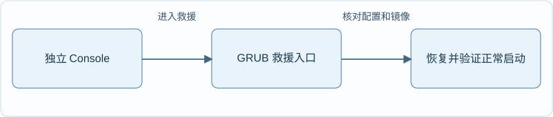

# 通过控制台进入救援 配置案例

## 操作流程



(case-conditions-installation-system-recovery)=
## 配置条件

准备本地键盘和显示器，或可以看到 GRUB 的串口。若需要保留设备业务配置，先在可用环境导出并备份。

## 配置步骤

1. 重启设备并等待 GRUB 出现。保留系统盘，移除安装介质。
2. 根据连接选择 `VortexROS recovery (local display)` 或 `VortexROS recovery (serial)`。
3. 按 Console 提示核对镜像与配置。保留要继续使用的配置，确认后再返回正常启动。

(case-verification-installation-system-recovery)=
## 验证方法

对照以下命令和预期结果核对设备状态。

恢复后从 Console 登录常规 CLI。

```vortexros-cli
display startup
display health
display users
```

核对启动的镜像与配置文件，再验证正常账户登录和业务路径。需要清除设备设置时，参见[配置恢复与出厂重置](../../operator/09-operations/factory-reset.md)。
