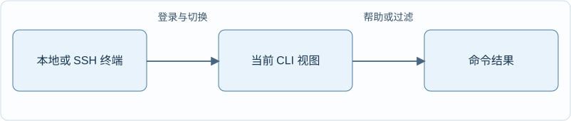

(section-operator-01-cli-navigation-1)=
# 命令行视图、帮助与过滤

<span id="overview"></span>

设备 CLI 区分用户视图、系统视图和各功能视图。可用问号查询命令或已有对象，用 Tab 补齐唯一匹配项。

<span id="principles"></span>

(section-operator-01-cli-navigation-2)=
## 工作原理

问号给出当前命令上下文的帮助，Tab 补齐唯一匹配项。显示命令可用管道筛选，分页中断保留终端会话。

<span id="examples"></span>

(section-operator-01-cli-navigation-3)=
## 配置与验证

(section-operator-01-cli-navigation-4)=
### 操作流程



(case-conditions-01-cli-navigation)=
### 配置条件

使用本地 Console 或 STelnet 登录。账户权限决定可以使用的命令。

(section-operator-01-cli-navigation-5)=
### 配置步骤

登录后处于用户视图：

```text
<VortexROS> system-view
[~VortexROS] interface Vlanif 100
[~VortexROS-Vlanif100] return
<VortexROS>
```

`?` 先列出当前位置的参数类型，再列可用关键字。`<IMAGE-FILE>` 这样的尖括号标签表示要填写的值，下面列出的文件名可以直接使用。看到 `<cr>` 就可以直接按回车，页面上也可能同时列出子命令。Tab 在唯一匹配时补齐词并进入下一词位。命令关键字可以缩写到当前上下文中的唯一前缀。接口视图的二层和三层命令随当前候选配置变化，例如切到 `portswitch` 后，帮助不列出三层地址和 DHCP 命令。

分页默认每 30 行显示 `---more---`：空格下一页、Enter下一行、`q`或 Ctrl+C结束显示。结束分页不会关闭会话，也不会产生多余空行。

输出过滤：

```vortexros-cli
display current-configuration | include ospf
display interface brief | include eth
```

表格过滤保留必要的标题、分隔线和汇总行。

(case-verification-01-cli-navigation)=
### 验证方法

对照以下命令和预期结果核对设备状态。

```vortexros-cli
display current-configuration | include ospf
display interface brief
```

核对接口和配置摘要。进入三层接口时使用问号查看可用命令，切换为交换接口后对照两种模式的帮助。

输入 `display system-software ?` 时可继续输入 `operation` 查询任务，也可按回车查看已安装软件。查询单一接口的 ICMP 策略时，`Ethernet0` 和 `Ethernet 0` 都可使用。完整接口名后可直接按回车。

<span id="observed"></span>

(closeout-result-operator-01-cli-navigation)=
### 操作帮助和显示的实测结果

三节点回归通过用户视图和系统视图中的帮助、配置和显示。已确认未启用的路径会在相应视图列出可用参数，配置提交后再按当前对象查询。实际配置查询和运行结果参见 [提交与保存](configuration.md)。

以下是系统软件查询的实测帮助。看到最后一行后可直接按回车查看镜像清单。

```text
<VortexROS> display system-software ?
  operation  Display a software operation
  |          output modifiers
  <cr>       execute command
```

<span id="precautions"></span>

(section-operator-01-cli-navigation-6)=
## 注意事项

接口模式和用户权限会影响可用命令。排查配置时先确认当前视图，再用问号核对后续参数。

<p data-legacy-id="id2" class="manual-previous-section" data-section-moved><a href="#overview">介绍</a></p>
<p data-legacy-id="id3" class="manual-previous-section" data-section-moved><a href="#case-conditions-01-cli-navigation">配置准备</a></p>
<p data-legacy-id="id4" class="manual-previous-section" data-section-moved><a href="#examples">配置案例</a></p>
<p data-legacy-id="id5" class="manual-previous-section" data-section-moved><a href="#case-verification-01-cli-navigation">验证配置</a></p>
