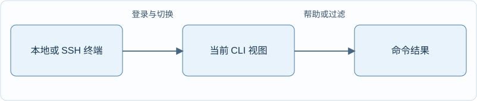

# 命令行视图、帮助与过滤 配置案例

## 操作流程



(case-conditions-01-cli-navigation)=
## 配置条件

使用本地 Console 或 STelnet 登录。账户权限决定可以使用的命令。

## 配置步骤

登录后处于用户视图：

```text
<VortexROS> system-view
[~VortexROS] interface Vlanif 100
[~VortexROS-Vlanif100] return
<VortexROS>
```

`?` 显示当前位置的关键字、参数范围或已有对象。Tab 在唯一匹配时补齐词并进入下一词位。命令关键字可以缩写到当前上下文中的唯一前缀。接口视图的二层和三层命令随当前候选配置变化，例如切到 `portswitch` 后，帮助不列出三层地址和 DHCP 命令。

分页默认每 30 行显示 `---more---`：空格下一页、Enter下一行、`q`或 Ctrl+C结束显示。结束分页不会关闭会话，也不会产生多余空行。

输出过滤：

```vortexros-cli
display current-configuration | include ospf
display interface brief | include eth
```

表格过滤保留必要的标题、分隔线和汇总行。

(case-verification-01-cli-navigation)=
## 验证方法

对照以下命令和预期结果核对设备状态。

```vortexros-cli
display current-configuration | include ospf
display interface brief
```

核对接口和配置摘要。进入三层接口时使用问号查看可用命令，切换为交换接口后对照两种模式的帮助。
