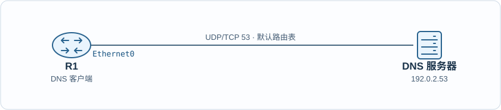

# 配置本机 DNS 服务器

## 拓扑



## 配置条件

确认 DNS 服务器在默认路由表中可达。192.0.2.53 是示例地址。

## 配置步骤

```vortexros-config
dns resolve
dns server 192.0.2.53
#
return
```

在系统视图录入后提交。撤销时用 `undo dns server 192.0.2.53` 删除该服务地址，用 `undo dns resolve` 关闭动态解析，随后提交。

## 验证方法

对照{ref}`本功能页的实测结果 <recorded-result-02-system-services-dns>`可以核对设备实际显示的字段或业务表现。不同拓扑请按本案例的地址和接口检查。

对照以下命令和预期结果核对设备状态。

```vortexros-cli
display dns server
```

确认配置地址为 192.0.2.53，从设备使用真实可解析的主机名发起访问，检查能得到预期目标地址。
