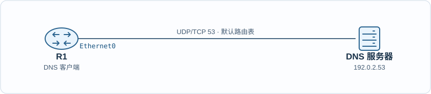

# 使用管理域名及搜索后缀

## 拓扑



## 配置条件

确认 DNS 服务器在默认路由表中可达。192.0.2.53 是示例地址。

设备的管理口应能经默认路由到达 192.0.2.53。DNS 服务器预先为 router1.example.test 设置 A 或 AAAA 记录。

## 配置步骤

```vortexros-config
dns resolve
dns server 192.0.2.53
dns domain example.test
#
return
```

提交后查看 `display dns server` 和 `display dns domain`。服务器表应有 192.0.2.53，搜索域表应有 example.test。从设备使用完整域名和短主机名访问目标，正常时应解析为同一地址。

## 验证方法

对照以下命令和预期结果核对设备状态。

```vortexros-cli
display dns server
display dns domain
```

服务器列表应出现 192.0.2.53，搜索域应包含 example.test。用短主机名和完整域名访问同一个目标，核对两者解析结果。
