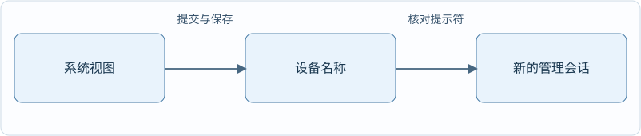

# 设备名称与登录提示 配置案例

## 操作流程



(case-conditions-02-system-services-identity)=
## 配置条件

按站点和角色选用设备名称。下例使用 EDGE-01，可替换为实际名称。

## 配置步骤

在系统视图输入以下配置并提交。

```vortexros-config
sysname EDGE-01
#
return
```

如果原会话还显示旧提示符，可开启新会话查看。确认后执行 `save`。

(case-verification-02-system-services-identity)=
## 验证方法

对照以下命令和预期结果核对设备状态。

```vortexros-cli
display current-configuration | include sysname
display version
```

检查配置中是否为 `sysname EDGE-01`，并从新会话核对 CLI 提示符。修改名称时重复同样步骤。
