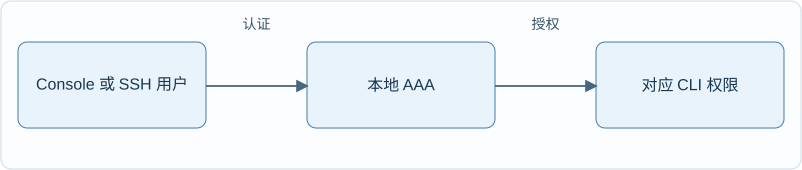

(section-operator-02-system-services-local-aaa-1)=
# 本地 AAA 与用户权限

<span id="overview"></span>

本地 AAA 管理登录设备的账户和操作权限，适用于 Console 和 SSH 管理。默认认证域为 default，采用本地认证。Level 1 为只读、Level 2 为网络管理员、Level 3 为系统管理员。

<span id="principles"></span>

(section-operator-02-system-services-local-aaa-2)=
## 工作原理

本地 AAA 用 Level 1、2、3 区分用户权限，并可分别限制 Console 和 SSH 服务。

<span id="examples"></span>

(section-operator-02-system-services-local-aaa-3)=
## 配置与验证

(section-operator-02-system-services-local-aaa-4)=
### 操作流程



(case-conditions-02-system-services-local-aaa)=
### 配置条件

使用 Level 3 登录。新增管理员时保留已验证的 Console 会话。

(section-operator-02-system-services-local-aaa-5)=
### 配置步骤

创建一个只读账户 audit。输入密码命令时按交互提示录入设备专用口令。

```text
system-view
aaa
local-user audit privilege level 1
local-user audit password irreversible-cipher
local-user audit service-type terminal ssh
quit
commit
return
```

(case-verification-02-system-services-local-aaa)=
### 验证方法

对照以下命令和预期结果核对设备状态。

```vortexros-cli
display aaa user audit
display current-configuration configuration aaa
```

检查 audit 的权限等级和允许的服务，再用该账户登录，确认可以查询状态。已保存的口令显示为不可逆校验值。新增后先验证再执行 save。

<span id="observed"></span>

(query-result-02-system-services-local-aaa)=
### 命令回显实测节选

为只读账号启动本地会话后执行 display users。加号标出当前会话。已认证的只读账号能够列出会话，尝试进入系统视图会被权限检查拒绝。

```text
<VortexROS> display users
   User-Intf   Delay      Type  Network Address  AuthenStatus  AuthorcmdFlag
+  -           00:00:00   -     -                pass          yes            Username : qa-role1
   1   CON 1   00:00:00   CON   -                pass          yes            Username : vortexros
```

<span id="precautions"></span>

(section-operator-02-system-services-local-aaa-6)=
## 注意事项

变更管理员权限前保留独立 Console 会话。新增或删除远程权限后，用另一会话复查。

<p data-legacy-id="id1" class="manual-previous-section" data-section-moved><a href="#overview">介绍</a></p>
<p data-legacy-id="id2" class="manual-previous-section" data-section-moved><a href="#case-conditions-02-system-services-local-aaa">配置准备</a></p>
<p data-legacy-id="id3" class="manual-previous-section" data-section-moved><a href="#examples">配置案例</a></p>
<p data-legacy-id="id4" class="manual-previous-section" data-section-moved><a href="#case-verification-02-system-services-local-aaa">验证配置</a></p>
