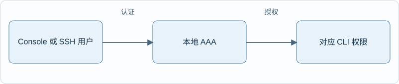

# 本地 AAA 与用户权限 配置案例

## 操作流程



(case-conditions-02-system-services-local-aaa)=
## 配置条件

使用 Level 3 登录。新增管理员时保留已验证的 Console 会话。

## 配置步骤

创建一个只读账户 audit。输入密码命令时按交互提示录入设备专用口令。

```text
system-view
aaa
local-user audit privilege level 1
local-user audit password irreversible-cipher
local-user audit service-type terminal ssh
quit
commit
return
```

(case-verification-02-system-services-local-aaa)=
## 验证方法

对照以下命令和预期结果核对设备状态。

```vortexros-cli
display aaa user audit
display current-configuration configuration aaa
```

检查 audit 的权限等级和允许的服务，再用该账户登录，确认可以查询状态。已保存的口令显示为不可逆校验值。新增后先验证再执行 save。
