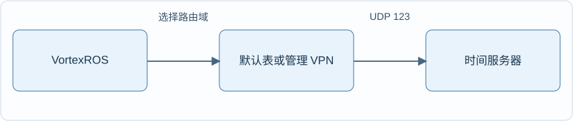

# 在不同 VPN 使用相同时间源地址

## 拓扑



## 配置条件

确认时间源可达。使用 vpn-instance 前先创建相应的 VPN 并准备到服务器的路由。

默认表与 MGMT 各自可到达 192.0.2.123，两个时间源位于隔离的管理网络。管理员先配置 MGMT 上联与路由；两台时间服务器均允许设备的 UDP 123 请求。

## 配置步骤

```vortexros-config
ip vpn-instance MGMT
 ipv4-family
#
ntp-service unicast-server 192.0.2.123 version 4
ntp-service unicast-server 192.0.2.123 vpn-instance MGMT version 4 preference
#
return
```

## 验证方法

对照以下命令和预期结果核对设备状态。

```vortexros-cli
display current-configuration configuration ntp
display ntp-service sessions
display ntp-service status
```

两条会话应按默认表和 MGMT 分开显示。等待采样后应至少有一条可达时间源，并在 status 看到同步后的参考源和偏移。若 MGMT 路径中断，复查其可达性和当前选源，再恢复上联。
