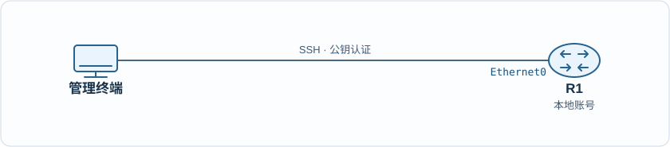

(section-operator-02-system-services-ssh-public-key-1)=
# SSH 公钥认证

<span id="overview"></span>

将用户的 OpenSSH 公钥导入设备并按名称关联到账户，适用于管理终端的免口令公钥认证。

<span id="principles"></span>

(section-operator-02-system-services-ssh-public-key-2)=
## 工作原理

支持命名 RSA、Ed25519 公钥，可将导入的公钥绑定到指定本地用户。

<span id="examples"></span>

(section-operator-02-system-services-ssh-public-key-3)=
## 配置与验证

(section-operator-02-system-services-ssh-public-key-4)=
### 拓扑



(case-conditions-02-system-services-ssh-public-key)=
### 配置条件

准备客户端公钥文件，并确认 STelnet 已可用。只复制 .pub 文件内容。

(section-operator-02-system-services-ssh-public-key-5)=
### 配置步骤

在系统视图输入 `rsa peer-public-key workstation encoding-type openssh`。进入命名视图后执行 `public-key-code begin`，在下一行粘贴本机的 OpenSSH 公钥整行或 Base64 数据。执行 `public-key-code end` 完成录入，`peer-public-key end` 返回系统视图。

```text
ssh user vortexros authentication-type rsa
ssh user vortexros assign rsa-key workstation
commit
return
display aaa user vortexros
```

Ed25519 使用 `ed25519 peer-public-key`、`authentication-type ed25519` 和 `assign ed25519-key`。撤销时用 `undo ssh user vortexros assign rsa-key workstation`，提交后从独立会话验证相应密钥已经失效。

(case-verification-02-system-services-ssh-public-key)=
### 验证方法

对照以下命令和预期结果核对设备状态。

```vortexros-cli
display aaa user vortexros
display ssh user vortexros login-info succeeded
display ssh user vortexros login-info failed
```

从客户端使用与 workstation 公钥配对的私钥发起新会话，检查对应用户出现在成功记录中。撤销后先从独立会话复验。

[STelnet 与 VTY](stelnet.md)

<span id="observed"></span>

(result-operator-02-system-services-ssh-public-key)=
### 导入和绑定公钥的实测结果

r5 的交互命令验证覆盖粘贴完整的 OpenSSH RSA 公钥行，以及向对应公钥视图粘贴纯 Base64 数据。完成录入、命名绑定并提交后，分别用 RSA 和 Ed25519 实际建立 SSH 管理会话。

<span id="precautions"></span>

(section-operator-02-system-services-ssh-public-key-6)=
## 注意事项

设备端只导入公钥。启用或撤销后，从独立终端发起新登录核对，原有会话无法验证新认证结果。

<p data-legacy-id="id1" class="manual-previous-section" data-section-moved><a href="#overview">介绍</a></p>
<p data-legacy-id="id2" class="manual-previous-section" data-section-moved><a href="#case-conditions-02-system-services-ssh-public-key">配置准备</a></p>
<p data-legacy-id="id3" class="manual-previous-section" data-section-moved><a href="#examples">配置案例</a></p>
<p data-legacy-id="id4" class="manual-previous-section" data-section-moved><a href="#case-verification-02-system-services-ssh-public-key">验证配置</a></p>
