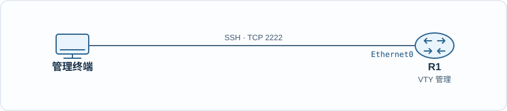

(section-operator-02-system-services-stelnet-1)=
# STelnet 与 VTY

<span id="overview"></span>

STelnet 通过 SSH 提供远程 CLI。VTY 管理远端会话数量和空闲超时。

<span id="principles"></span>

(section-operator-02-system-services-stelnet-2)=
## 工作原理

STelnet 提供 SSH 登录和 CLI 会话。监听端口、VTY 会话数、超时和本地用户权限可分别配置。

<span id="examples"></span>

(section-operator-02-system-services-stelnet-3)=
## 配置与验证

(section-operator-02-system-services-stelnet-4)=
### 拓扑



(case-conditions-02-system-services-stelnet)=
### 配置条件

先检查管理地址与回程路由，准备具备 SSH 登录权限的账户，并保留 Console。配置非默认端口时同时调整管理路径上的访问规则。

(section-operator-02-system-services-stelnet-5)=
### 配置步骤

```text
system-view
stelnet server enable
ssh server port 2222
user-interface maximum-vty 5
user-interface vty
idle-timeout 10
quit
commit
return
display users
display aaa user vortexros
```

在另一终端以 SSH 实际登录后执行 `save`。`display users` 显示 Console、VTY、远端地址和会话状态。`display ssh user login-info failed` 或 `display ssh user vortexros login-info succeeded` 可按结果和用户查询。

(case-verification-02-system-services-stelnet)=
### 验证方法

对照以下命令和预期结果核对设备状态。

```vortexros-cli
display users
display process tcp listen
display ssh user login-info succeeded
```

确认端口 2222 处于监听状态。从另一终端登录后，VTY 行应显示 SSH、远端地址和用户名。通过后执行 save。

[本地 AAA 与用户权限](local-aaa.md) · [SSH 公钥认证](ssh-public-key.md)

<span id="observed"></span>

(query-result-02-system-services-stelnet)=
### 命令回显实测节选

r5 实测两把公钥均能建立管理会话。成功记录的 Method 为 publickey。另一次 SSH 请求使用有效公钥，但请求执行远程命令，历史将该会话记为 failed 并保留原因。

```text
<VortexROS> display ssh user vortexros login-info succeeded
Time                     Source          User       Method     Result     Reason
2026-11-26 09:45:24 UTC  10.0.2.2:25906  vortexros  publickey  succeeded  Management session opened
2026-11-26 09:45:23 UTC  10.0.2.2:25904  vortexros  publickey  succeeded  Management session opened
```

```text
<VortexROS> display ssh user vortexros login-info failed
Time                     Source          User       Method     Result  Reason
2026-11-26 09:45:24 UTC  10.0.2.2:25918  vortexros  publickey  failed  remote commands are not supported
```

<span id="precautions"></span>

(section-operator-02-system-services-stelnet-6)=
## 注意事项

变更端口或权限前保留 Console。用另一条新 SSH 会话验证后再停止旧入口。

<p data-legacy-id="id1" class="manual-previous-section" data-section-moved><a href="#overview">介绍</a></p>
<p data-legacy-id="id2" class="manual-previous-section" data-section-moved><a href="#case-conditions-02-system-services-stelnet">配置准备</a></p>
<p data-legacy-id="id3" class="manual-previous-section" data-section-moved><a href="#examples">配置案例</a></p>
<p data-legacy-id="id4" class="manual-previous-section" data-section-moved><a href="#case-verification-02-system-services-stelnet">验证配置</a></p>
