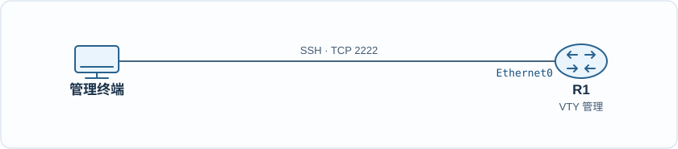

# STelnet 与 VTY 配置案例

## 拓扑



(case-conditions-02-system-services-stelnet)=
## 配置条件

先检查管理地址与回程路由，准备具备 SSH 登录权限的账户，并保留 Console。配置非默认端口时同时调整管理路径上的访问规则。

## 配置步骤

```text
system-view
stelnet server enable
ssh server port 2222
user-interface maximum-vty 5
user-interface vty
idle-timeout 10
quit
commit
return
display users
display aaa user vortexros
```

在另一终端以 SSH 实际登录后执行 `save`。`display users` 显示 Console、VTY、远端地址和会话状态。`display ssh user login-info failed` 或 `display ssh user vortexros login-info succeeded` 可按结果和用户查询。

(case-verification-02-system-services-stelnet)=
## 验证方法

对照以下命令和预期结果核对设备状态。

```vortexros-cli
display users
display process tcp listen
display ssh user login-info succeeded
```

确认端口 2222 处于监听状态。从另一终端登录后，VTY 行应显示 SSH、远端地址和用户名。通过后执行 save。

[本地 AAA 与用户权限](../local-aaa.md) · [SSH 公钥认证](../ssh-public-key.md)
