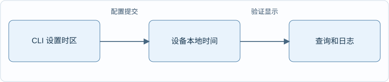

(section-operator-02-system-services-timezone-1)=
# 系统时区

<span id="overview"></span>

时区决定时间、运行状态和日志的本地显示方式。它不改变时间同步所使用的实际时刻。

<span id="principles"></span>

(section-operator-02-system-services-timezone-2)=
## 工作原理

使用 IANA 时区名称显示本机时间和日志。用户视图可立即应用，系统视图随配置提交。

<span id="examples"></span>

(section-operator-02-system-services-timezone-3)=
## 配置与验证

(section-operator-02-system-services-timezone-4)=
### 操作流程



(case-conditions-02-system-services-timezone)=
### 配置条件

用 `clock timezone ?` 查询有效的 IANA 时区名称。

(section-operator-02-system-services-timezone-5)=
### 配置步骤

```vortexros-cli
system-view
clock timezone Asia/Shanghai
commit
return
display clock
save
```

也可在用户视图直接设置时区，此时更改立即提交。用 `undo clock timezone` 恢复 UTC。

(case-verification-02-system-services-timezone)=
### 验证方法

对照以下命令和预期结果核对设备状态。

```vortexros-cli
display clock
display logbuffer last 10
```

核对时区与本地时间。需要保留该设置时执行 save。

<span id="observed"></span>

(result-operator-02-system-services-timezone)=
### 时区显示对照的实测结果

将设备时区切换至东八区后，核对 display clock 和同一事件的产品日志。两处实测都按 +08:00 显示。本机时区变更不影响事件的先后顺序。

(r4-result-operator-02-system-services-timezone)=
### 默认时区的实测回显

r4 空盘启动后的本机时钟。对照时间后的 UTC 偏移和下一行的时区名称。配置自己的时区后重新检查这两项。

```text
<VortexROS> display clock
2026-11-26 20:57:44 UTC+00:00
Time zone: Etc/UTC
```

<span id="precautions"></span>

(section-operator-02-system-services-timezone-6)=
## 注意事项

执行 save 后才可在重启后保留设置。需要比较不同设备的事件时，留意时间字段的时区。

<p data-legacy-id="id2" class="manual-previous-section" data-section-moved><a href="#overview">介绍</a></p>
<p data-legacy-id="id3" class="manual-previous-section" data-section-moved><a href="#case-conditions-02-system-services-timezone">配置准备</a></p>
<p data-legacy-id="id4" class="manual-previous-section" data-section-moved><a href="#examples">配置案例</a></p>
<p data-legacy-id="id5" class="manual-previous-section" data-section-moved><a href="#case-verification-02-system-services-timezone">验证配置</a></p>
