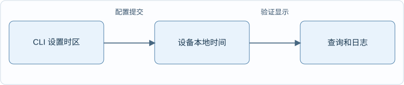

# 系统时区 配置案例

## 操作流程



(case-conditions-02-system-services-timezone)=
## 配置条件

用 `clock timezone ?` 查询有效的 IANA 时区名称。

## 配置步骤

```vortexros-cli
system-view
clock timezone Asia/Shanghai
commit
return
display clock
save
```

也可在用户视图直接设置时区，此时更改立即提交。用 `undo clock timezone` 恢复 UTC。

(case-verification-02-system-services-timezone)=
## 验证方法

对照以下命令和预期结果核对设备状态。

```vortexros-cli
display clock
display logbuffer last 10
```

核对时区与本地时间。需要保留该设置时执行 save。
