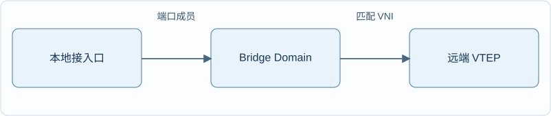

# 将 VLAN 和 VXLAN 加入普通 BD

## 拓扑



## 配置条件

普通 VLAN 的可用 VID 为 1–4094。高位 BD 可使用 4096–4294967294，适用于显式引用桥域的业务。普通 STP、RSTP 和 MSTP 的适用范围不变。

## 配置步骤

```text
bridge-domain 11
 l2 binding vlan 100
 vxlan vni 1011
interface Vbdif 11
 ip address 10.11.0.1 255.255.255.0
```

验证BD、VNI、MAC学习和L3网关：

## 验证方法

对照{ref}`本功能页的实测结果 <recorded-result-03-interfaces-l2-bridge-domain>`可以核对设备实际显示的字段或业务表现。不同拓扑请按本案例的地址和接口检查。

对照以下命令和预期结果核对设备状态。

```vortexros-cli
display bridge-domain 11
display mac-address
display interface Vbdif 11
```

删除前先解除Vbdif、VNI和VLAN绑定，避免业务仍在引用BD。
