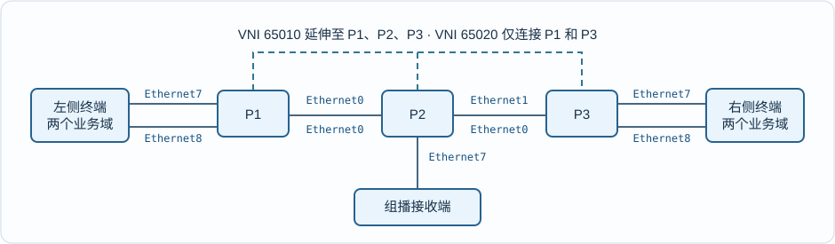

# 高位 BD 动态 EVPN 配置

## 拓扑


## 配置条件

普通 VLAN 的可用 VID 为 1–4094。高位 BD 可使用 4096–4294967294，适用于显式引用桥域的业务。普通 STP、RSTP 和 MSTP 的适用范围不变。

## 配置步骤

```text
system-view
evpn-overlay enable
bridge-domain 65536
vxlan vni 65010
evpn
route-distinguisher 65000:1101
vpn-target 65000:65010 import-extcommunity
vpn-target 65000:65010 export-extcommunity
quit
quit
interface Ethernet0
bridge-domain 65536
quit
interface Nve1
vni 65010 head-end peer-list protocol bgp
quit
commit
```

部署高位 EVPN 时，用 `display bridge-domain` 和 `display mac-address` 核对域归属和 MAC 学习，再检查 VNI、远端 VTEP 和 EVPN 路由。迁移网关或成员后，确认旧位置的远端 MAC/IP 已撤销并在新位置重新学习。可以在不同域使用同一客户 VID 或 MAC，验证时应检查域间隔离和域内连通。

撤销该 VNI 的动态通告时，在对应 NVE 视图执行 `undo vni 65010 head-end peer-list protocol bgp` 并提交。随后核对受影响域的远端状态和其余域的转发。

## 验证方法

对照{ref}`本功能页的实测结果 <recorded-result-03-interfaces-l2-bridge-domain>`可以核对设备实际显示的字段或业务表现。不同拓扑请按本案例的地址和接口检查。

对照以下命令和预期结果核对设备状态。

```vortexros-cli
display bridge-domain 65536
display mac-address bridge-domain 65536
display vxlan tunnel
```

确认 65536 对应 VNI 65010 和指定接入口。终端发包后应出现对应 BD 的 MAC，两个 VTEP 之间验证实际连通。

### 两个高位 BD 并行的实测



在 P1 与 P3 两个站点各增加一个业务接入口，用同样的步骤配置 BD `65537`、VNI `65020` 和独立的 RT `65000:65020`。两个 BD 可以使用相同的客户 IPv4、IPv6 地址和 MAC，各自只在所在域学习。P1 和 P3 的 VTEP 源分别为 `10.255.0.1` 和 `10.255.0.3`。实测两侧客户 IPv4 为 `198.19.43.11`、`198.19.43.33`，IPv6 为 `2001:db8:43::11`、`2001:db8:43::33`。

实测中两域各自双向可达，迁移 VNI 65010 内的终端后，相关 IPv4 和 IPv6 的 MAC/IP 在新位置出现，VNI 65020 持续转发。撤销 P1 的 VNI 65010 后，核对 P3 对应远端 MAC/IP 撤销，另一个 VNI 保留。重新挂载后确认双向恢复。

分别查询两个 BD 的 MAC，核对网关通告和业务邻居。已知的 ARP/ND 由对应域处理，未知请求仍按该域转发。验证组播时，在第三台 VTEP P2 的 `Ethernet7` 接入接收端，将接口绑定到 BD 65536，按前面的相同 RT 将 VNI 65010 加入本机 NVE。用 `239.42.42.42` 和 `ff3e::4242` 分别验证 IPv4 和 IPv6。实测只有对应订阅的 VXLAN 出口获得该流量，撤销监听与重新加入后，转发随之变化。

| 实测步骤 | 正常业务端口 | 隔离对照端口 |
| --- | --- | --- |
| 迁移同一 MAC | 新位置收到带客户 VID 101 的报文 | 其他域未收到 |
| 撤销其中一个 VNI | 另一域继续收到带客户 VID 101 的报文 | 已撤销 VNI 无转发 |
| 协议或数据面重启并收敛 | 既有业务恢复，客户 VID 101 保持 | 域间仍未收到对方报文 |
