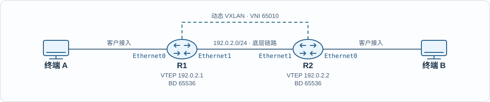

# 高位 BD 动态 EVPN 配置

## 拓扑



## 配置条件

普通 VLAN 的可用 VID 为 1–4094。高位 BD 可使用 4096–4294967294，适用于显式引用桥域的业务。普通 STP、RSTP 和 MSTP 的适用范围不变。

## 配置步骤

```text
system-view
evpn-overlay enable
bridge-domain 65536
vxlan vni 65010
evpn
route-distinguisher 65000:1101
vpn-target 65000:65010 import-extcommunity
vpn-target 65000:65010 export-extcommunity
quit
quit
interface Ethernet0
bridge-domain 65536
quit
interface Nve1
vni 65010 head-end peer-list protocol bgp
quit
commit
```

部署高位 EVPN 时，用 `display bridge-domain` 和 `display mac-address` 核对域归属和 MAC 学习，再检查 VNI、远端 VTEP 和 EVPN 路由。迁移网关或成员后，确认旧位置的远端 MAC/IP 已撤销并在新位置重新学习。可以在不同域使用同一客户 VID 或 MAC，验证时应检查域间隔离和域内连通。

撤销该 VNI 的动态通告时，在对应 NVE 视图执行 `undo vni 65010 head-end peer-list protocol bgp` 并提交。随后核对受影响域的远端状态和其余域的转发。

## 验证方法

对照{ref}`本功能页的实测结果 <recorded-result-03-interfaces-l2-bridge-domain>`可以核对设备实际显示的字段或业务表现。不同拓扑请按本案例的地址和接口检查。

对照以下命令和预期结果核对设备状态。

```vortexros-cli
display bridge-domain 65536
display mac-address bridge-domain 65536
display vxlan tunnel
```

确认 65536 对应 VNI 65010 和指定接入口。终端发包后应出现对应 BD 的 MAC，两个 VTEP 之间验证实际连通。
