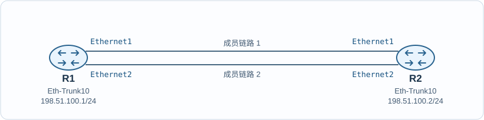

# 配置聚合与增删成员

## 拓扑



## 配置条件

示例使用 Ethernet1 和 Ethernet2。先移除成员上独立的二三层业务配置，并确保对端采用相同模式及 MTU。

聚合接口默认L3，支持static和LACP；成员必须是物理接口并满足兼容属性。加入后，成员不再允许独立配置L2/L3参数，聚合无关的ACL/QoS绑定按能力保留。

## 配置步骤

```text
interface Eth-Trunk 10
 mode lacp-static
 trunkport Ethernet 1 to Ethernet 2
 mtu 9000
 ip address 198.51.100.1 255.255.255.0
```

```vortexros-cli
display eth-trunk 10
display interface Eth-Trunk 10
```

删除单个成员或整个聚合接口：

```text
interface Eth-Trunk 10
 undo trunkport Ethernet 2
quit
undo interface Eth-Trunk 10
commit
```

成员口退出聚合后，才可重新配置其独立的二层/三层属性。

## 验证方法

对照以下命令和预期结果核对设备状态。

```vortexros-cli
display eth-trunk 10
display interface brief
```

确认聚合口下出现实际成员及状态。移除指定成员后仅该成员退出，并用剩余链路测试。
