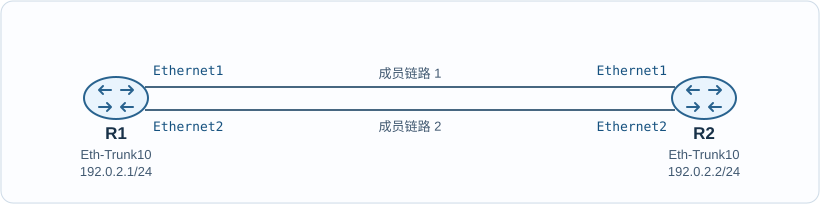

# 两台设备双链路 LACP

## 拓扑



## 配置条件

示例使用 Ethernet1 和 Ethernet2。先移除成员上独立的二三层业务配置，并确保对端采用相同模式及 MTU。

两端 Ethernet1 对接 Ethernet1、Ethernet2 对接 Ethernet2。清空成员口独立地址与交换配置。两端均用 Eth-Trunk10，管理地址为 192.0.2.1/24 和 .2/24。

## 配置步骤

**本端设备**

```vortexros-config
interface Eth-Trunk 10
 mode lacp-static
 trunkport Ethernet 1 to Ethernet 2
 ip address 192.0.2.1 255.255.255.0
#
return
```

**对端设备**

```vortexros-config
interface Eth-Trunk 10
 mode lacp-static
 trunkport Ethernet 1 to Ethernet 2
 ip address 192.0.2.2 255.255.255.0
#
return
```

## 验证方法

对照{ref}`本功能页的实测结果 <recorded-result-03-interfaces-l2-eth-trunk>`可以核对设备实际显示的字段或业务表现。不同拓扑请按本案例的地址和接口检查。

对照以下命令和预期结果核对设备状态。

```vortexros-cli
display eth-trunk 10
display interface brief
display ip interface brief
```

配置提交后，两端应看到 Eth-Trunk10 up，两个成员均被选中，接口简表里成员位于聚合项下方。持续 ping 对端后断开一根成员链路，聚合仍 up 并由另一根链路转发。接回后复查两成员。
