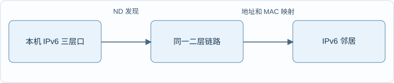

# 设置静态 IPv6 邻居与老化

## 拓扑



## 配置条件

选定三层接口并确认对端 IPv6 和单播 MAC 地址。动态表项由流量学习。

## 配置步骤

```vortexros-config
enable switch
vlan 10
#
interface Vlanif 10
 ipv6 enable
 ipv6 address 2001:db8:10::1 64
#
ipv6 nd stale-timeout 1800
ipv6 nd max-number 65536
ipv6 nd recycle enable
ipv6 neighbor 2001:db8:10::2 02:11:22:33:44:55 interface Vlanif10
#
return
```

录入后提交。表满时，回收策略只处理动态表项。要删除静态邻居，使用完整的 `undo ipv6 neighbor 2001:db8:10::2 02:11:22:33:44:55 interface Vlanif10` 后提交。

## 验证方法

对照{ref}`本功能页的实测结果 <recorded-result-03-interfaces-l2-ipv6-neighbor-discovery>`可以核对设备实际显示的字段或业务表现。不同拓扑请按本案例的地址和接口检查。

对照以下命令和预期结果核对设备状态。

```vortexros-cli
display ipv6 nd
display ipv6 neighbors static
```

确认静态 IPv6、MAC、接口和表的老化设置相符。用同链路流量核对实际转发。
