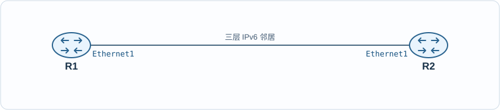

# 按 VPN 或接口定位邻居

## 拓扑



## 配置条件

选定三层接口并确认对端 IPv6 和单播 MAC 地址。动态表项由流量学习。

## 配置步骤

```vortexros-cli
display ipv6 neighbors Vlanif 10
display ipv6 neighbors interface Ethernet 1
display ipv6 neighbors vpn-instance BLUE
display ipv6 neighbors dynamic
```

如果 Vlanif10 与 BLUE 已存在，可从对应网段发起流量后核对动态邻居。查询静态邻居时应看到已配置的 IPv6、单播 MAC 与接口。

如需恢复默认老化、容量与回收，在系统视图执行下列命令。

```text
undo ipv6 nd stale-timeout
undo ipv6 nd max-number
undo ipv6 nd recycle
commit
```

提交后再次执行 `display ipv6 nd`，核对设备默认值。

## 验证方法

对照以下命令和预期结果核对设备状态。

```vortexros-cli
display ipv6 neighbors interface Ethernet 1
display ipv6 neighbors vpn-instance BLUE
```

从对应网段发送流量后，确认查询只列出所选接口或 VPN 的动态条目。撤销回收策略后可通过 display ipv6 nd 核对默认设置。
