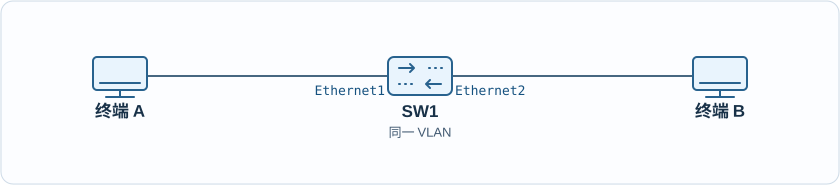

# 调整动态 MAC 老化时间

## 拓扑



## 配置条件

在已经可以收发流量的 VLAN 上观察动态学习。全局老化时间调整会影响已有 VLAN。

启用交换功能后，每个VLAN对应的转发域默认采用以下行为：

## 配置步骤

- 动态MAC学习：开启；
- 广播和组播泛洪：开启；
- 未知单播泛洪：开启；
- 二层转发：开启；
- 动态MAC老化时间：300秒。

动态MAC老化时间是全局参数。需要修改时，在系统视图执行：

```text
mac-address aging-time 600
commit
```

提交后，所有VLAN对应转发域的动态MAC老化时间变为600秒。恢复默认值：

```text
undo mac-address aging-time
commit
```

默认值不显示在配置中；只有非默认值才进入 `display current-configuration`。配置值必须是 60 秒的整数倍。

## 验证方法

对照{ref}`本功能页的实测结果 <recorded-result-03-interfaces-l2-mac-table>`可以核对设备实际显示的字段或业务表现。不同拓扑请按本案例的地址和接口检查。

对照以下命令和预期结果核对设备状态。

```vortexros-cli
display mac-address
display current-configuration
```

确认配置记录为 600 秒。让终端停止发包后观察动态表项老化，静态表项不应因此删除。
