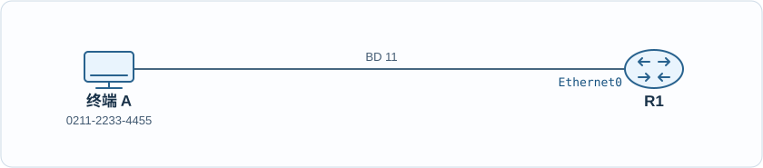

# 配置静态 MAC 表项

## 拓扑



## 配置条件

在已经可以收发流量的 VLAN 上观察动态学习。全局老化时间调整会影响已有 VLAN。

已知终端的固定接入口时，可在对应桥域中配置静态表项。以下示例要求 Ethernet0 已属于 BD 11。

## 配置步骤

```text
mac-address static 02:11:22:33:44:55 Ethernet0 bridge-domain 11
commit
```

提交后检查该 MAC 的固定出口。搬迁终端时先更新或撤销该表项，再验证流量到达新位置。

## 验证方法

对照{ref}`本功能页的实测结果 <recorded-result-03-interfaces-l2-mac-table>`可以核对设备实际显示的字段或业务表现。不同拓扑请按本案例的地址和接口检查。

对照以下命令和预期结果核对设备状态。

```vortexros-cli
display mac-address
```

核对指定 MAC 在 BD 11 指向 Ethernet0，终端收到实际业务后再验证迁移或撤销。
