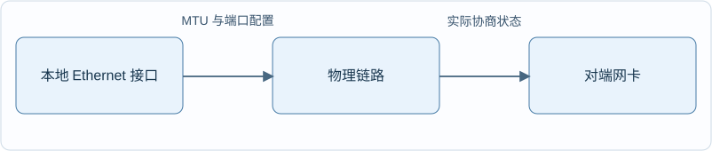

(section-operator-03-interfaces-l2-physical-interfaces-1)=
# 物理接口与硬件卸载

<span id="overview"></span>

物理接口可以作为三层端口或二层交换端口。接口配置包括描述、MTU、地址和受支持的硬件卸载功能。

<span id="principles"></span>

(section-operator-03-interfaces-l2-physical-interfaces-2)=
## 工作原理

接口简表的 PHY 表示物理链路或管理状态，Proto 表示接口可承载上层协议的状态。先确认管理开关和线侧载波，再检查三层地址或二层成员资格。网卡从 Linux 切换到 VPP 后，用 Type 和数据面拓扑表确认当前归属。

物理接口可在三层地址配置与二层交换之间切换，支持查询链路、错误、MTU 和网卡卸载能力。

<span id="examples"></span>

(section-operator-03-interfaces-l2-physical-interfaces-3)=
## 配置与验证

(section-operator-03-interfaces-l2-physical-interfaces-4)=
### 拓扑



(case-conditions-03-interfaces-l2-physical-interfaces)=
### 配置条件

先检查网线、对端和实际接口名称。只有设备支持的卸载项才能配置。调整 MTU 前应统一链路两端参数。

(section-operator-03-interfaces-l2-physical-interfaces-5)=
### 配置步骤

**R1**

```vortexros-config
interface Ethernet 1
 description uplink
 mtu 9000
 ip address 192.0.2.2 255.255.255.0
 undo hardware offload tso tx-checksum rx-checksum
#
return
```

录入前在 R1 执行 `display interface hardware offload Ethernet1`，确认支持示例中的卸载项。示例同时关闭 TSO 及收发校验和卸载。只配置链路地址和 MTU 时可省略卸载命令。用 `hardware offload` 加对应选项重新启用卸载。

**R2**

```vortexros-config
interface Ethernet 1
 description to-R1
 mtu 9000
 ip address 192.0.2.1 255.255.255.0
#
return
```

两端从系统视图分别录入并执行 `commit`。从 R1 先测试普通报文，再发送总长 9000 字节的 IPv4 ICMP 报文。`-f` 禁止 IPv4 分片，`-s` 设置负载大小。

```vortexros-cli
ping 192.0.2.1
ping -f -s 8972 192.0.2.1
```

(case-verification-03-interfaces-l2-physical-interfaces)=
### 验证方法

对照以下命令和预期结果核对设备状态。

```vortexros-cli
display interface brief
display interface Ethernet 1
display interface hardware offload Ethernet1
```

设备只允许一个转发平面管理物理接口。VPP未启用时，可在CLI中配置Linux能够识别的物理口；VPP接管完成后，只允许配置设备已经识别的业务接口。接管过程中接口配置暂时只读，避免同一接口同时由两套转发平面管理。

```vortexros-cli
display vpp interface-ownership verbose
display interface brief
display ip interface brief
display ipv6 interface brief
```

状态含义：`^down`表示配置对象已创建但尚不满足底层数据面创建条件；普通`down`表示底层对象存在但链路或协议条件未满足。接口无IP不应因此down。

`display interface brief`中的`CRC`只显示网卡驱动提供的硬件CRC/FCS坏帧计数；驱动或虚拟接口不支持该计数时显示`--`。它不会把接口down期间的发送尝试、转发丢弃或其他软件错误混入CRC。使用`display interface <接口>`查看CRC/FCS、丢弃、punt以及收发方向的软件错误明细。

如果 IP 简表暂时显示 unavailable 或 unknown，等待接口恢复后重新查看。

本例预期两端 Ethernet1 均为 `up`，`MTU` 为 `9000`。若执行了卸载配置，检查 R1 对应的活动卸载状态。只看到接口 Up 时，从实际对端再确认收发。

`display interface`中的最近up/down时间来自接口实际状态变化，不会因为执行display而重置。设备无法确认的历史时间显示 `-`；修改时区只会改变时间的显示方式。

InUti/OutUti 为最近 300 秒的平均速率占比。完整观察窗口形成前，摘要可能显示 0.0%。

### 批量配置同类端口

下面在同一台设备上为已存在的 Ethernet2 和 Ethernet3 设置公共描述。范围包含两端口。所选接口需要属于同一类型与命令分区，各自不同的配置请进入单个端口设置。

```vortexros-cli
system-view
interface range Ethernet2 to Ethernet3
 description access-row-a
 quit
commit
return
display interface Ethernet 2
display interface Ethernet 3
```

预期两个端口都显示 `Description: access-row-a`。若这两个端口起初没有描述，可在同一范围使用 `undo description` 并提交。端口原有描述不同的，逐个恢复。

<span id="observed"></span>

(section-operator-03-interfaces-l2-physical-interfaces-6)=
### 两口已接管的实测回显

两块 Virtio 口交给 DPDK 后，接口简表的 Type 为 DPDK。链接状态和接口模式应分别核对。

```text
<VortexROS> display interface brief
Interface               PHY    Proto   InUti  OutUti  CRC    Type      MTU
Ethernet0               up     up       0.0%    0.0%   --    DPDK      1500
Ethernet1               up     up       0.0%    0.0%   --    DPDK      1500
```

<span id="precautions"></span>

(section-operator-03-interfaces-l2-physical-interfaces-7)=
## 注意事项

卸载选项依网卡和活动驱动而异。调整 MTU、端口模式和硬件卸载前先核对对端及当前管理链路。

<p data-legacy-id="id2" class="manual-previous-section" data-section-moved><a href="#overview">介绍</a></p>
<p data-legacy-id="id3" class="manual-previous-section" data-section-moved><a href="#case-conditions-03-interfaces-l2-physical-interfaces">配置准备</a></p>
<p data-legacy-id="id4" class="manual-previous-section" data-section-moved><a href="#examples">配置案例</a></p>
<p data-legacy-id="id5" class="manual-previous-section" data-section-moved><a href="#case-verification-03-interfaces-l2-physical-interfaces">验证配置</a></p>
