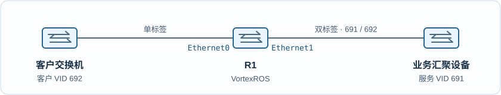

# QinQ 二层接入

QinQ 在已有的客户 VLAN 标签外再加一层服务 VLAN 标签。运营商或园区汇聚可按服务 VLAN 区分客户线路，同时保留客户自己的 VLAN 编号。

## 工作原理

| 使用场景 | 选择 |
| --- | --- |
| 客户端口的流量统一进入一个服务 VLAN | 在客户口用 `port link-type dot1q-tunnel`，在服务侧 Trunk 放行该服务 VLAN。 |
| 按指定外层和内层 VID 把流量导入一个桥域 | 显式建立 `mode l2` 子接口，配置 `encapsulation qinq` 和 `bridge-domain`。 |
| 在 VortexROS 上为双标签业务做路由网关 | 使用[三层子接口](subinterfaces.md)的 VLAN 终结。 |

简单 QinQ 把服务标签用在汇聚链路。客户原来的 VID、PCP 和 DEI 随帧穿过服务链路。灵活 QinQ 只匹配指定标签，依照子接口配置决定标签改写方式。

## 配置与验证

### 简单 QinQ 保留客户标签



R1 的 Ethernet0 接客户交换机，Ethernet1 接服务汇聚。客户发送 VID 692 的帧，服务链路以 VID 691 承载它。对端汇聚口应放行外层 VID 691，并对双标签帧提供对应业务。测试前确认物理链路支持额外的标签长度。

```vortexros-cli
system-view
enable switch
vlan batch 691 692
interface Ethernet 0
 portswitch
 port link-type dot1q-tunnel
 port default vlan 691
 quit
interface Ethernet 1
 portswitch
 port link-type trunk
 undo port trunk allow-pass vlan 1
 port trunk allow-pass vlan 691
 quit
commit
return
```

```vortexros-cli
display vlan 691
display interface Ethernet 0
display interface Ethernet 1
display mac-address vlan 691
```

预期两个端口均处于 VLAN 691 的转发范围。业务成功后在 MAC 表中按客户源 MAC 查学习端口。双标签转发和 PCP/DEI 需要在链路两侧抓包。下表来自已验证的二层用例，端口名按上图整理。

| 注入帧 | 实测出端结果 |
| --- | --- |
| 客户侧 VID 692，PCP 5，DEI 1 | 服务侧外层 VID 691，内层仍为 VID 692、PCP 5、DEI 1。 |
| 服务侧外层 VID 691，内层 VID 692 | 客户侧仅剩 VID 692，客户 PCP/DEI 保持。 |
| 服务侧外层误用 VID 692 | 客户侧没有收到该帧。 |

### 灵活 QinQ 按标签范围接入桥域

```{toctree}
:maxdepth: 1

subinterfaces/cases/example-3
```

## 注意事项

简单 QinQ 客户口的整个物理口都用于接入，该父口不配置显式子接口。计划撤销业务时，先确认服务 VLAN 上的其他接入口，撤除本链路的成员后再决定是否删除 VLAN。修改后复查标签和双向流量。
