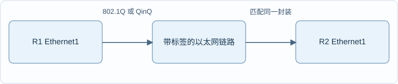

# 单标签与双标签三层终结

## 拓扑



## 配置条件

确保父接口按三层模式工作。对端须发送与相应子接口匹配的单标签或双标签。

## 配置步骤

```text
interface Ethernet 1.100
 vlan-type dot1q 100
 ip address 10.100.0.1 255.255.255.0
```

QinQ示例：

```text
interface Ethernet 1.200
 vlan-type dot1q 200 inner 20
 ip address 10.200.20.1 255.255.255.0
```

提交后，只有标签匹配的报文进入对应子接口。父接口down时子接口随之down；父接口恢复后自动恢复。使用以下命令验证：

## 验证方法

对照以下命令和预期结果核对设备状态。

```vortexros-cli
display interface Ethernet 1.100
display ip interface brief
display ip routing-table protocol direct
```
