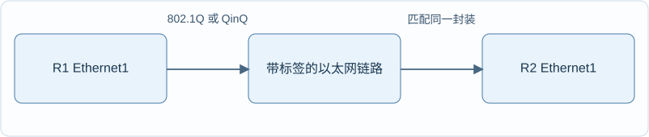

# 两端的 802.1Q 三层子接口

## 拓扑



## 配置条件

确保父接口按三层模式工作。对端须发送与相应子接口匹配的单标签或双标签。

将 R1 和 R2 的 Ethernet1 直连。VLAN 100 和 200 分别使用不同的 IPv4 子网。父接口保持三层模式。

## 配置步骤

两台设备分别在系统视图录入各自的配置片段，退出功能视图后提交。

**R1**

```vortexros-config
interface Ethernet 1.100
 vlan-type dot1q 100
 ip address 198.51.100.1 255.255.255.0
#
interface Ethernet 1.200
 vlan-type dot1q 200
 ip address 203.0.113.1 255.255.255.0
#
return
```

**R2**

```vortexros-config
interface Ethernet 1.100
 vlan-type dot1q 100
 ip address 198.51.100.2 255.255.255.0
#
interface Ethernet 1.200
 vlan-type dot1q 200
 ip address 203.0.113.2 255.255.255.0
#
return
```

## 验证方法

对照{ref}`本功能页的实测结果 <recorded-result-03-interfaces-l2-subinterfaces>`可以核对设备实际显示的字段或业务表现。不同拓扑请按本案例的地址和接口检查。

对照以下命令和预期结果核对设备状态。

```vortexros-cli
display interface Ethernet 1.100
display interface Ethernet 1.200
display ip interface brief
```

两端的 1.100 与 1.200 均应为 up，各自 IP 正确。分别 ping 对端 198.51.100.x 与 203.0.113.x。两端标签不一致时，对应网络的流量无法由正确的子接口接收。
