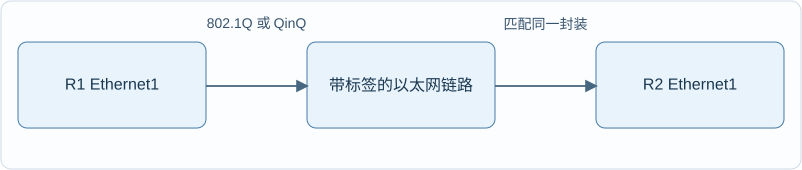

# 灵活 QinQ 二层接入

## 拓扑



## 配置条件

确保父接口按三层模式工作。对端须发送与相应子接口匹配的单标签或双标签。

每端 Ethernet1 连客户上联，外层 VID 为 200，客户内层允许 20–29。每端 Ethernet2 接业务侧，显式加入 BD 20。先分别在两端提交以下相同配置。该拓扑可与静态 VXLAN 组合，按其案例在两个 BD 20 间建立相同 VNI，把本地业务延伸到对端。

## 配置步骤

```vortexros-config
bridge-domain 20
#
interface Ethernet 1.200 mode l2
 encapsulation qinq vid 200 ce-vid 20 to 29
 rewrite pop none
 bridge-domain 20
#
interface Ethernet 2
 bridge-domain 20
#
return
```

## 验证方法

对照{ref}`本功能页的实测结果 <recorded-result-03-interfaces-l2-subinterfaces>`可以核对设备实际显示的字段或业务表现。不同拓扑请按本案例的地址和接口检查。

对照以下命令和预期结果核对设备状态。

```vortexros-cli
display interface Ethernet 1.200
display bridge-domain 20
display ip interface brief
```

1.200 应归属 BD 20，普通接口状态中能看到它，IP 简表中没有该二层口。用可生成双标签的客户设备分别测试 200/20、200/29 和 200/30，前两组应进入 BD 20，最后一组不应匹配。对端采用相同的标签约定。
