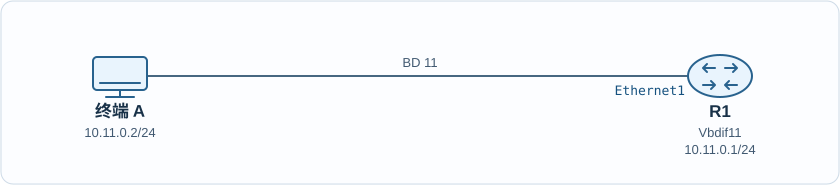

(section-operator-03-interfaces-l2-vbdif-1)=
# Vbdif 三层网关

<span id="overview"></span>

Vbdif 是 Bridge Domain 的网关接口。它让桥域中的终端通过网关地址访问其他网段。

<span id="principles"></span>

(section-operator-03-interfaces-l2-vbdif-2)=
## 工作原理

Vbdif 让设备在一个桥域上终结三层流量。它和二层成员共享桥域，但网关地址应在 Vbdif 上维护。EVPN 场景还要核对其它 VTEP 是否通过控制平面学到网关 MAC/IP。

Vbdif 为 BD 提供 IPv4 或 IPv6 网关，可配合 EVPN 通告网关 MAC/IP。

<span id="examples"></span>

(section-operator-03-interfaces-l2-vbdif-3)=
## 配置与验证

(section-operator-03-interfaces-l2-vbdif-4)=
### 拓扑



(case-conditions-03-interfaces-l2-vbdif)=
### 配置条件

先建立 Bridge Domain 11，配置能承载业务的本地接入口或 VXLAN。

(section-operator-03-interfaces-l2-vbdif-5)=
### 配置步骤

```vortexros-config
bridge-domain 11
#
interface Vbdif 11
 ip address 10.11.0.1 255.255.255.0
#
return
```

录入并提交。客户端以 10.11.0.1 作为网关。移除桥域前先解除 Vbdif 及其路由和协议引用。

(case-verification-03-interfaces-l2-vbdif)=
### 验证方法

对照以下命令和预期结果核对设备状态。

```vortexros-cli
display interface Vbdif 11
display bridge-domain 11
display ip routing-table protocol direct
```

确认网关处于工作状态，桥域和网关编号对应，直连路由指向 Vbdif11。再从桥域终端测试网关和远端地址。

<span id="observed"></span>

(section-operator-03-interfaces-l2-vbdif-6)=
### 运行查询实测节选

r4 的实际网关接口。需同时确认 UP、地址和归属桥域。

```text
<VortexROS> display interface Vbdif 101
Vbdif101 current state : UP
Line protocol current state : UP
Internet Address is 192.0.2.5/30
Bridge-domain: 101 (bvi)
```

<span id="precautions"></span>

(section-operator-03-interfaces-l2-vbdif-7)=
## 注意事项

Vbdif 和 BD 编号必须对应。确认至少存在可用成员，再检查网关地址和三层路径。

<p data-legacy-id="id1" class="manual-previous-section" data-section-moved><a href="#overview">介绍</a></p>
<p data-legacy-id="id2" class="manual-previous-section" data-section-moved><a href="#case-conditions-03-interfaces-l2-vbdif">配置准备</a></p>
<p data-legacy-id="id3" class="manual-previous-section" data-section-moved><a href="#examples">配置案例</a></p>
<p data-legacy-id="id4" class="manual-previous-section" data-section-moved><a href="#case-verification-03-interfaces-l2-vbdif">验证配置</a></p>
