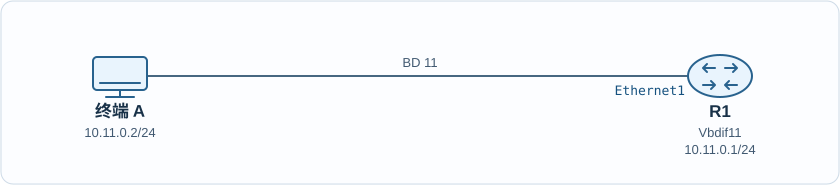

# Vbdif 三层网关 配置案例

## 拓扑



(case-conditions-03-interfaces-l2-vbdif)=
## 配置条件

先建立 Bridge Domain 11，配置能承载业务的本地接入口或 VXLAN。

## 配置步骤

```vortexros-config
bridge-domain 11
#
interface Vbdif 11
 ip address 10.11.0.1 255.255.255.0
#
return
```

录入并提交。客户端以 10.11.0.1 作为网关。移除桥域前先解除 Vbdif 及其路由和协议引用。

(case-verification-03-interfaces-l2-vbdif)=
## 验证方法

对照以下命令和预期结果核对设备状态。

```vortexros-cli
display interface Vbdif 11
display bridge-domain 11
display ip routing-table protocol direct
```

确认网关处于工作状态，桥域和网关编号对应，直连路由指向 Vbdif11。再从桥域终端测试网关和远端地址。
