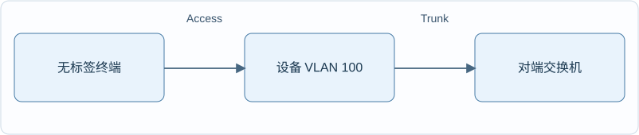

(section-operator-03-interfaces-l2-vlan-1)=
# VLAN 二层交换

<span id="overview"></span>

VLAN 把同一台设备上的二层交换范围分开。Access 端口连接无标签终端，Trunk 端口在链路上传递指定 VLAN。

<span id="principles"></span>

(section-operator-03-interfaces-l2-vlan-2)=
## 工作原理

未打标签帧在入端按端口默认 VLAN 归类，带标签帧按标签和允许列表归类。转发只在命中的 VLAN 内查表和泛洪，出端再按端口配置决定保留或去除标签。

Access 端口连接无标签终端，Trunk 端口承载多个 VLAN。相同 VLAN 的端口共享该二层域。

<span id="examples"></span>

(section-operator-03-interfaces-l2-vlan-3)=
## 配置与验证

(section-operator-03-interfaces-l2-vlan-4)=
### 拓扑



(case-conditions-03-interfaces-l2-vlan)=
### 配置条件

准备 Ethernet1 连接交换机，Ethernet2 连接 VLAN 100 的终端。检查对端 Trunk 的允许 VLAN。

(section-operator-03-interfaces-l2-vlan-5)=
### 配置步骤

```vortexros-config
enable switch
vlan batch 100 200
#
interface Ethernet 1
 portswitch
 port link-type trunk
 port trunk allow-pass vlan 100 200
#
interface Ethernet 2
 portswitch
 port link-type access
 port default vlan 100
#
return
```

录入上述配置后执行 commit。

(case-verification-03-interfaces-l2-vlan)=
### 验证方法

对照以下命令和预期结果核对设备状态。

```vortexros-cli
display vlan
display mac-address
```

`display vlan`使用一张表同时显示状态、MAC学习、描述和端口成员，端口状态中的`U/D`表示up/down，`TG/UT`表示tagged/untagged。表格宽度根据实际内容调整；端口之间间隔两个字符，每行最多显示四个端口，更多端口在下一行按首个接口位置继续显示：

```text
-----------------------------------------------------------------
U: Up;         D: Down;         TG: Tagged;         UT: Untagged;
-----------------------------------------------------------------

VID  Type    Status  MAC-LRN  Description    Ports
-----------------------------------------------------------------
1    common  enable  enable   VLAN 1         UT:eth2(D)  eth3(D)
10   common  enable  enable   To_CTC_ISP     UT:eth0(U)
20   common  enable  enable   To_LAN_Client  UT:eth1(U)
-----------------------------------------------------------------
```

核对 VLAN 100 的有标签与无标签成员。同 VLAN 内应能互通，不同 VLAN 间的互通需经三层网关。

<span id="observed"></span>

(section-operator-03-interfaces-l2-vlan-6)=
### 运行查询实测节选

r4 接入口划入 VLAN 200 后，查询显示该 VLAN 的状态及出端标签方式。测试拓扑的接入口保留 `host-p1q*` 名称。

```text
<VortexROS> display vlan 200
--------------------------------------------------------------------------------------
U: Up;         D: Down;         TG: Tagged;         UT: Untagged;
--------------------------------------------------------------------------------------

VID    Type      Status    MAC-LRN    Description      Ports
--------------------------------------------------------------------------------------
200    common    enable    enable     VLAN 200         UT:host-p1q12(U)  host-p1q13(U)
--------------------------------------------------------------------------------------
```

<span id="precautions"></span>

(section-operator-03-interfaces-l2-vlan-7)=
## 注意事项

检查 Trunk 两端的允许列表和本端 PVID。需要跨 VLAN 通信时应配置三层转发。

<p data-legacy-id="id1" class="manual-previous-section" data-section-moved><a href="#overview">介绍</a></p>
<p data-legacy-id="id2" class="manual-previous-section" data-section-moved><a href="#case-conditions-03-interfaces-l2-vlan">配置准备</a></p>
<p data-legacy-id="id3" class="manual-previous-section" data-section-moved><a href="#examples">配置案例</a></p>
<p data-legacy-id="id4" class="manual-previous-section" data-section-moved><a href="#case-verification-03-interfaces-l2-vlan">验证配置</a></p>
