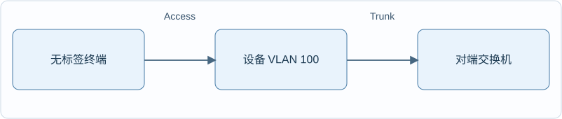

# VLAN 二层交换 配置案例

## 拓扑



(case-conditions-03-interfaces-l2-vlan)=
## 配置条件

准备 Ethernet1 连接交换机，Ethernet2 连接 VLAN 100 的终端。检查对端 Trunk 的允许 VLAN。

## 配置步骤

```vortexros-config
enable switch
vlan batch 100 200
#
interface Ethernet 1
 portswitch
 port link-type trunk
 port trunk allow-pass vlan 100 200
#
interface Ethernet 2
 portswitch
 port link-type access
 port default vlan 100
#
return
```

录入上述配置后执行 commit。

(case-verification-03-interfaces-l2-vlan)=
## 验证方法

对照以下命令和预期结果核对设备状态。

```vortexros-cli
display vlan
display mac-address
```

`display vlan`使用一张表同时显示状态、MAC学习、描述和端口成员，端口状态中的`U/D`表示up/down，`TG/UT`表示tagged/untagged。表格宽度根据实际内容调整；端口之间间隔两个字符，每行最多显示四个端口，更多端口在下一行按首个接口位置继续显示：

```text
-----------------------------------------------------------------
U: Up;         D: Down;         TG: Tagged;         UT: Untagged;
-----------------------------------------------------------------

VID  Type    Status  MAC-LRN  Description    Ports
-----------------------------------------------------------------
1    common  enable  enable   VLAN 1         UT:eth2(D)  eth3(D)
10   common  enable  enable   To_CTC_ISP     UT:eth0(U)
20   common  enable  enable   To_LAN_Client  UT:eth1(U)
-----------------------------------------------------------------
```

核对 VLAN 100 的有标签与无标签成员。同 VLAN 内应能互通，不同 VLAN 间的互通需经三层网关。
