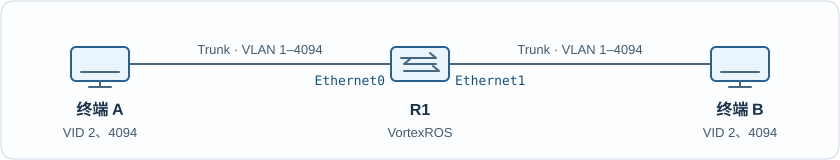

# 让两条 Trunk 同时承载 4094 个 VLAN

此案例用于核对 Trunk 批量配置、保存回放和高、低 VID 转发。请在独立测试设备或维护窗口执行。

## 拓扑与配置条件



终端 A 和终端 B 各连接一条 Trunk。两端均能发送和接收 802.1Q 帧，分别建立 VID 2 与 4094 的测试子接口。

| VLAN | 终端 A | 终端 B |
| --- | --- | --- |
| 2 | `198.51.100.1/24` | `198.51.100.2/24` |
| 4094 | `203.0.113.1/24` | `203.0.113.2/24` |

## 配置步骤

先在 R1 创建全部普通 VLAN。独立提交创建操作，可以区分 VLAN 是否创建成功与端口是否已放行。

```vortexros-cli
system-view
enable switch
vlan batch 1 to 4094
commit
```

再从系统视图配置两条 Trunk。

```vortexros-cli
interface Ethernet 0
 portswitch
 port link-type trunk
 port trunk allow-pass vlan all
 quit
interface Ethernet 1
 portswitch
 port link-type trunk
 port trunk allow-pass vlan all
 quit
commit
return
```

## 验证

```vortexros-cli
display vlan summary
display vlan 2
display vlan 4094
```

签名开发镜像的实测节选如下。`TG` 表示出端带标签，`U` 表示端口 Up。列表中第二个端口沿用同一标签类型。

```text
<VortexROS> display vlan 4094
VID     Type      Status    MAC-LRN    Description      Ports
-------------------------------------------------------------------------------------
4094    common    enable    enable     VLAN 4094        TG:Ethernet0(U)  Ethernet1(U)
-------------------------------------------------------------------------------------
```

从两个终端分别对同 VLAN 的地址发起 Ping。该拓扑实测两个 VID 每方向均收到 2/2 回应。确认结果后执行 `save`。在维护窗口重启后，再次查询成员并测试两个 VID。

## 撤销和复查

先清除两端口的放行列表，再删除这次用于实验的 VLAN 2–4094。若同一设备上的其他业务也使用这些 VLAN，只撤除本案例的 Trunk 放行，保留相关 VLAN。

```vortexros-cli
system-view
interface Ethernet 0
 undo port trunk allow-pass vlan all
 quit
interface Ethernet 1
 undo port trunk allow-pass vlan all
 quit
undo vlan batch 2 to 4094
commit
return
display vlan
```

本案例完成撤销后，实测 `The total number of vlans is : 1`，只保留默认 VLAN 1。两个测试 VLAN 的探测均没有应答。`undo port trunk allow-pass vlan all` 也清除对 VLAN 1 的默认放行，端口的 PVID 配置与放行列表分别检查。另需撤回原来的交换模式时，按现场原配置恢复接口。
