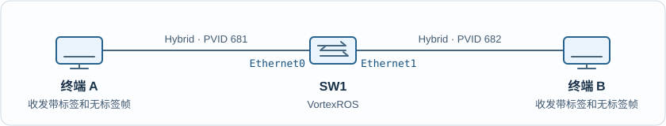

# Hybrid 接口同时发送带标签和无标签流量

用 Hybrid 端口分别控制入端无标签分类、出端标签和允许成员。此例让两个对端以不同的标签约定接入同一二层设备。

## 拓扑与配置条件



终端 A 接 SW1 Ethernet0，终端 B 接 SW1 Ethernet1。准备可发送和识别 802.1Q 标签的测试终端。无标签入端使用各自端口的 PVID。

| SW1 端口 | 无标签入端 PVID | 出端带标签 | 出端去标签 |
| --- | --- | --- | --- |
| Ethernet0 | 681 | 682 | 681 |
| Ethernet1 | 682 | 681 | 682 |

## 配置步骤

```vortexros-cli
system-view
enable switch
vlan batch 681 682
interface Ethernet 0
 portswitch
 port link-type hybrid
 undo port hybrid untagged vlan 1
 port hybrid pvid vlan 681
 port hybrid untagged vlan 681
 port hybrid tagged vlan 682
 quit
interface Ethernet 1
 portswitch
 port link-type hybrid
 undo port hybrid untagged vlan 1
 port hybrid pvid vlan 682
 port hybrid tagged vlan 681
 port hybrid untagged vlan 682
 quit
commit
return
```

## 验证

```vortexros-cli
display vlan 681
display vlan 682
display mac-address vlan 681
display mac-address vlan 682
```

预期 VLAN 681 显示 Ethernet0 为 `UT`、Ethernet1 为 `TG`。VLAN 682 的标签方式相反。已用以下类型的报文在进、出端验证实际行为。

| 从 Ethernet0 进入 | Ethernet1 上的实测结果 |
| --- | --- |
| 无标签帧 | 带标签 VID 681。 |
| 带标签 VID 681、PCP 5、DEI 1 | 保留 VID 681、PCP 5 和 DEI 1。 |
| 带标签 VID 682 | 去除 VLAN 标签。 |
| 带标签 VID 683 | 没有收到该帧。 |

反向从 Ethernet1 发送带标签 VID 682 时，Ethernet0 的出端保留 VID 682。上线前核对两边对同一业务 VID 的标签约定。撤销或更改前先记录原成员与 PVID，恢复后用上述命令和两端流量复查。
