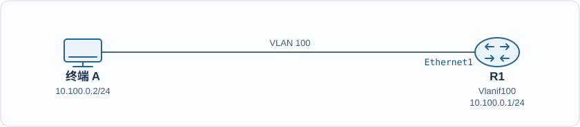

(section-operator-03-interfaces-l2-vlanif-1)=
# Vlanif 三层网关

<span id="overview"></span>

Vlanif 为一个 VLAN 提供三层接口，可作为终端默认网关并在网段之间路由。

<span id="principles"></span>

(section-operator-03-interfaces-l2-vlanif-2)=
## 工作原理

同 VLAN 的终端经二层交换通信，Vlanif 承担该 VLAN 的三层网关。给 Vlanif 配置 IP 后，设备把对应网段作为连接路由处理。跨 VLAN 业务还需要各端网关和返回路径正确。

Vlanif 提供 VLAN 网关并生成相应的直连路由。最后一个可用成员退出时，接口和直连路由状态会变化。

<span id="examples"></span>

(section-operator-03-interfaces-l2-vlanif-3)=
## 配置与验证

(section-operator-03-interfaces-l2-vlanif-4)=
### 拓扑



(case-conditions-03-interfaces-l2-vlanif)=
### 配置条件

先建立 VLAN 100 并配置至少一个可用成员端口。

(section-operator-03-interfaces-l2-vlanif-5)=
### 配置步骤

```vortexros-config
enable switch
vlan 100
#
interface Vlanif 100
 ip address 10.100.0.1 255.255.255.0
#
return
```

录入后执行 commit。终端配置 10.100.0.1 作为默认网关。

(case-verification-03-interfaces-l2-vlanif)=
### 验证方法

对照以下命令和预期结果核对设备状态。

```vortexros-cli
display vlan
display interface Vlanif 100
display ip routing-table protocol direct
```

确认 Vlanif100 协议状态为 up，路由表存在 10.100.0.0/24 的直连路由。从终端测试网关。最后一个成员失去链路时，Vlanif 和对应直连路由会随之变化。

[VLAN 二层交换](vlan.md)

<span id="observed"></span>

(section-operator-03-interfaces-l2-vlanif-6)=
### 运行查询实测节选

r4 配置 Vlanif200 后，简表可检查该网关的地址及状态。以下只保留相关行。

```text
<VortexROS> display ip interface brief
Interface               IP Address/Mask     Physical  Protocol  VPN-Instance
Vlanif200               198.51.100.1/24     up        up        ALL
```

<span id="precautions"></span>

(section-operator-03-interfaces-l2-vlanif-7)=
## 注意事项

先创建 VLAN 与成员端口。访问网关失败时，同时核对二层成员和 Vlanif 的 PHY、Protocol。

<p data-legacy-id="id1" class="manual-previous-section" data-section-moved><a href="#overview">介绍</a></p>
<p data-legacy-id="id2" class="manual-previous-section" data-section-moved><a href="#case-conditions-03-interfaces-l2-vlanif">配置准备</a></p>
<p data-legacy-id="id3" class="manual-previous-section" data-section-moved><a href="#examples">配置案例</a></p>
<p data-legacy-id="id4" class="manual-previous-section" data-section-moved><a href="#case-verification-03-interfaces-l2-vlanif">验证配置</a></p>
