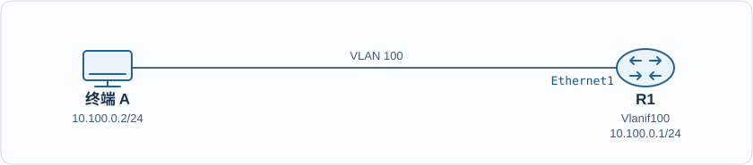

# Vlanif 三层网关 配置案例

## 拓扑



(case-conditions-03-interfaces-l2-vlanif)=
## 配置条件

先建立 VLAN 100 并配置至少一个可用成员端口。

## 配置步骤

```vortexros-config
enable switch
vlan 100
#
interface Vlanif 100
 ip address 10.100.0.1 255.255.255.0
#
return
```

录入后执行 commit。终端配置 10.100.0.1 作为默认网关。

(case-verification-03-interfaces-l2-vlanif)=
## 验证方法

对照以下命令和预期结果核对设备状态。

```vortexros-cli
display vlan
display interface Vlanif 100
display ip routing-table protocol direct
```

确认 Vlanif100 协议状态为 up，路由表存在 10.100.0.0/24 的直连路由。从终端测试网关。最后一个成员失去链路时，Vlanif 和对应直连路由会随之变化。

[VLAN 二层交换](../vlan.md)
