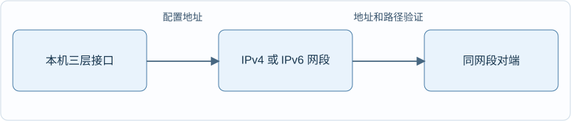

(section-operator-04-ip-routing-ip-addresses-1)=
# IPv4 与 IPv6 接口地址

<span id="overview"></span>

在三层接口配置 IPv4 或 IPv6 地址后，设备可以连接对应网段。同一 IPv4 接口可以有主地址和从地址，IPv6 地址逐条添加。

<span id="principles"></span>

(section-operator-04-ip-routing-ip-addresses-2)=
## 工作原理

接口地址决定本地终结的地址及直连网段。对非直连目标，设备仍需在合适的路由表中找到下一跳。验证时区分接口状态、直连前缀和远端应答。

三层接口可以配置一个 IPv4 主地址，使用 `ip address IP MASK sub` 追加从地址。启用 `ipv6 enable` 后，使用 `ipv6 address IP PREFIXLEN` 逐条配置 IPv6 地址。两个地址族的静态配置都没有固定的每接口地址条数上限。地址配置的实际规模受设备资源和提交耗时影响。

<span id="examples"></span>

(section-operator-04-ip-routing-ip-addresses-3)=
## 配置与验证

(section-operator-04-ip-routing-ip-addresses-4)=
### 拓扑



(case-conditions-04-ip-routing-ip-addresses)=
### 配置条件

准备 IPv4 掩码和 IPv6 前缀长度。接口必须处于三层模式。要使用 VPN，先绑定 VPN 再设地址。

下例将 R1 和 R2 的 Ethernet1 直连。主 IPv4 网段为 `192.0.2.0/24`，从地址使用 `198.51.100.0/24`。同一物理链路同时承载这两个 IPv4 网段和一个 IPv6 网段。

(section-operator-04-ip-routing-ip-addresses-5)=
### 配置步骤

**R1**

```vortexros-config
interface Ethernet 1
 ip address 192.0.2.2 255.255.255.0
 ip address 198.51.100.2 255.255.255.0 sub
 ipv6 enable
 ipv6 address 2001:db8:10::2 64
#
interface LoopBack 0
 ipv6 enable
 ipv6 address 2001:db8:100::1 64
 ipv6 address 2001:db8:200::1 64
#
return
```

**R2**

```vortexros-config
interface Ethernet 1
 ip address 192.0.2.1 255.255.255.0
 ip address 198.51.100.1 255.255.255.0 sub
 ipv6 enable
 ipv6 address 2001:db8:10::1 64
#
return
```

在两台设备的系统视图分别录入并提交。删除从地址时在对应接口视图执行 `undo ip address 198.51.100.2 255.255.255.0`，其中地址按该设备的配置替换。

(case-verification-04-ip-routing-ip-addresses)=
### 验证方法

对照以下命令和预期结果核对设备状态。

```vortexros-cli
display ip interface brief
display ipv6 interface brief
display ip routing-table protocol direct
display ipv6 routing-table protocol direct
```

两端 Ethernet1 在线时，IPv4 直连路由应同时包含 `192.0.2.0/24` 和 `198.51.100.0/24`，IPv6 应有 `2001:db8:10::/64`。从 R1 指定源地址测试各个网段。

```vortexros-cli
ping -a 192.0.2.2 192.0.2.1
ping -a 198.51.100.2 198.51.100.1
ping ipv6 2001:db8:10::1
```

<span id="observed"></span>

(section-operator-04-ip-routing-ip-addresses-6)=
### 运行查询实测节选

r4 三节点用于配置检查的 IPv4 接口简表节选。根据实际接口名找对应行，并核对两列 up/down。

```text
<VortexROS> display ip interface brief
*down: administratively down
^down: standby down
(s): spoofing

The number of interface that is UP in Physical is 11
The number of interface that is DOWN in Physical is 0
The number of interface that is UP in Protocol is 8
The number of interface that is DOWN in Protocol is 3

Interface               IP Address/Mask     Physical  Protocol  VPN-Instance
Nve1                    10.201.12.1/32      up        up        default
Tunnel0                 192.0.2.1/30        up        up        default
Vbdif101                192.0.2.5/30        up        up        default
Vbdif310                203.0.113.1/30      up        up        default
```

<span id="precautions"></span>

(section-operator-04-ip-routing-ip-addresses-7)=
## 注意事项

绑定 VPN 后再配置地址。地址和掩码须与链路及用途一致；更改时确认相关直连路由和下游回程。

<p data-legacy-id="id1" class="manual-previous-section" data-section-moved><a href="#overview">介绍</a></p>
<p data-legacy-id="id2" class="manual-previous-section" data-section-moved><a href="#case-conditions-04-ip-routing-ip-addresses">配置准备</a></p>
<p data-legacy-id="id3" class="manual-previous-section" data-section-moved><a href="#examples">配置案例</a></p>
<p data-legacy-id="id4" class="manual-previous-section" data-section-moved><a href="#case-verification-04-ip-routing-ip-addresses">验证配置</a></p>
