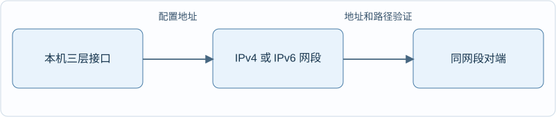

# IPv4 与 IPv6 接口地址 配置案例

## 拓扑



(case-conditions-04-ip-routing-ip-addresses)=
## 配置条件

准备 IPv4 掩码和 IPv6 前缀长度。接口必须处于三层模式。要使用 VPN，先绑定 VPN 再设地址。

## 配置步骤

```vortexros-config
interface Ethernet 1
 ip address 192.0.2.2 255.255.255.0
 ipv6 address 2001:db8:10::2 64
#
interface LoopBack 0
 ipv6 address 2001:db8:100::1 64
 ipv6 address 2001:db8:200::1 64
#
return
```

在系统视图录入上述片段并提交。删除地址时用相同地址和掩码的 undo 命令。

(case-verification-04-ip-routing-ip-addresses)=
## 验证方法

对照以下命令和预期结果核对设备状态。

```vortexros-cli
display ip interface brief
display ipv6 interface brief
display ip routing-table protocol direct
display ipv6 routing-table protocol direct
```

核对接口上实际生效的地址和所属 VPN。接口在线时，检查相应的直连路由并从同网段对端测试。
