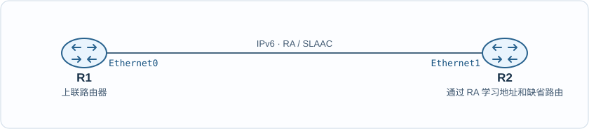

# 接收 RA 并取得 SLAAC 地址

## 拓扑



## 配置条件

确认上游在指定链路提供路由通告。独立使用 DHCPv6 时，仍需为默认路由准备 RA 或静态路由。

## 配置步骤

```vortexros-config
interface Ethernet 1
 ipv6 address auto global default
#
return
```

提交后，等待地址生成和重复地址检测完成。若只需其中一项，分别使用 `ipv6 address auto slaac` 或 `ipv6 nd ra default-route enable`。用 `undo ipv6 address auto global default` 撤销组合配置。

## 验证方法

对照{ref}`本功能页的实测结果 <recorded-result-04-ip-routing-ipv6-router-advertisement>`可以核对设备实际显示的字段或业务表现。不同拓扑请按本案例的地址和接口检查。

对照以下命令和预期结果核对设备状态。

```vortexros-cli
display ipv6 interface brief
display ipv6 routing-table
```

核对接口自动地址的前缀与 RA 一致。只有当上游提供有效默认路由通告时，路由表才应出现所学的缺省路由。
