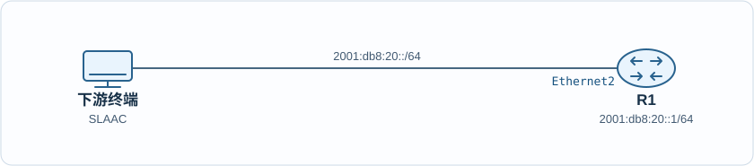

# 向下游发布 IPv6 前缀

## 拓扑



## 配置条件

确认上游在指定链路提供路由通告。独立使用 DHCPv6 时，仍需为默认路由准备 RA 或静态路由。

下例由 Ethernet2 向直连终端发布 2001:db8:20::/64。替换为实际下游接口和前缀后录入，再提交。

## 配置步骤

```vortexros-config
interface Ethernet 2
 ipv6 enable
 ipv6 address 2001:db8:20::1 64
 undo ipv6 nd ra halt
 ipv6 nd ra lifetime 1800
 ipv6 nd ra prefix 2001:db8:20:: 64 3600 1800
#
return
```

## 验证方法

对照以下命令和预期结果核对设备状态。

```vortexros-cli
display ipv6 interface brief
display ipv6 neighbors
```

检查 Ethernet2 的网关地址，从下游验证所获 IPv6 前缀及默认路由，并测试该网关。
