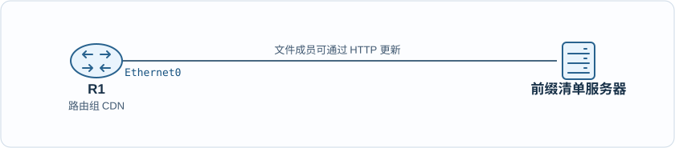

# 文件成员与URL成员

## 拓扑



## 配置条件

提前准备源文件或 URL、下一跳和 VPN。大批量变更前准备可用的回退配置。

路由组的外部列表统一存放在：

## 配置步骤

```text
/vortexros/route-static-groupd
```

管理员可先把每行一个CIDR的文件放到该目录，再在路由组视图中选择。`?`和Tab只列出目录顶层的普通文件，不接受子目录、符号链接或包含路径分隔符的名称：

```text
route-static group name CDN
 source file cdn-v4.txt
```

直接修改原文件不会立即改变已生效的路由。执行下面的命令才会重新读取、显示进度并增量更新路由：

```vortexros-cli
reset route-static group name CDN
```

URL与本地文件互斥。URL下载后的原始物化结果和元数据也由系统存放在同一目录的受管子目录中：

```text
route-static group name CDN
 source url https://lists.example.net/cdn-v4.txt vpn-instance BLUE
 auto-refresh enable
 auto-refresh interval 4320
```

URL默认必须使用HTTPS。只有明确接受明文传输的受控环境才可配置
`source url http://192.0.2.10/routes.txt insecure`；HTTPS来源不允许经重定向降级为HTTP。

两种来源的内容均为每行一个CIDR，空行和整行`#`注释跳过；任一非法行使新版本整体失效。手工与外部成员取并集。本地文件不支持`auto-refresh`；URL可按配置定时刷新。

首次配置URL后，执行全局 `commit` 会显示连接、下载、检查、应用和完成等进度；只有文件下载并检查成功后配置才会生效。后续普通commit不会重复下载：

```vortexros-cli
reset route-static group name CDN
display route-static group name CDN verbose
display ip routing-table group name CDN verbose
```

Ctrl+C只停止当前终端的进度显示，不取消设备正在执行的更新，也不关闭SSH。

## 验证方法

对照{ref}`本功能页的实测结果 <recorded-result-04-ip-routing-static-route-groups>`可以核对设备实际显示的字段或业务表现。不同拓扑请按本案例的地址和接口检查。

对照以下命令和预期结果核对设备状态。

```vortexros-cli
display route-static group name CDN verbose
display ip routing-table group name CDN verbose
```

核对当前活动来源和成员数。以有效更新替换列表后验证新增前缀和撤销前缀。
