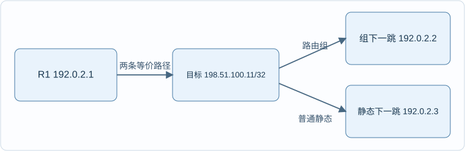

# 普通静态路由与路由组共同提供两条下一跳

## 拓扑



## 配置条件

提前准备源文件或 URL、下一跳和 VPN。大批量变更前准备可用的回退配置。

本机 Ethernet0 接入 192.0.2.0/24，地址 192.0.2.1。两个对端网关分别为 192.0.2.2 和 192.0.2.3，都能转发到同一个目标 198.51.100.11。对端应有到源业务网段的回程。下例在本机为目标配置两条相同优先级和 Tag 的路径。

## 配置步骤

```vortexros-config
interface Ethernet 0
 ip address 192.0.2.1 255.255.255.0
#
route-static group name CDN
 route 198.51.100.11/32
#
ip route-static group CDN 192.0.2.2 preference 60 tag 100
ip route-static 198.51.100.11 32 192.0.2.3 preference 60 tag 100
#
return
```

提交后查看组的安装状态，以及目的前缀的两条有效路径。

## 验证方法

对照以下命令和预期结果核对设备状态。

```vortexros-cli
display route-static group name CDN verbose
display ip routing-table 198.51.100.11 32 verbose
```

组应有一个成员及一个绑定。同一个目的应出现两个下一跳。多流转发时可从两个对端核对实际转发。仅解除组绑定并提交后，192.0.2.3 的普通静态路径应继续存在，目标仍可达。
