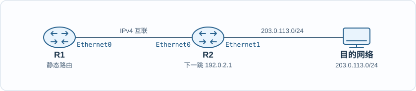

# 设置普通静态路由

## 拓扑



## 配置条件

确认下一跳在正确的路由表内可达。使用跨 VPN 下一跳时先创建相应 VPN。

## 配置步骤

```text
ip route-static 203.0.113.0 255.255.255.0 192.0.2.1 preference 60 tag 100 description TO-WAN
ip route-static vpn-instance BLUE 10.0.0.0 8 vpn-instance default 192.0.2.1 Tunnel 1
ipv6 route-static 2001:db8:100:: 64 2001:db8::1
```

输入后执行 commit。跨 VPN 路由按配置区分目标 VPN 与下一跳所在 VPN。确认业务后执行 save。

## 验证方法

对照{ref}`本功能页的实测结果 <recorded-result-04-ip-routing-static-routes>`可以核对设备实际显示的字段或业务表现。不同拓扑请按本案例的地址和接口检查。

对照以下命令和预期结果核对设备状态。

```vortexros-cli
display ip routing-table protocol static
display ipv6 routing-table protocol static
```

核对 IPv4、IPv6 的配置目的和实际下一跳。使用对应 VPN 与源地址探测目标。
