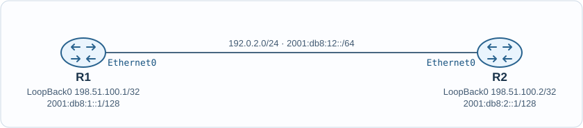

# 双栈主机路由与回程

## 拓扑



## 配置条件

确认下一跳在正确的路由表内可达。使用跨 VPN 下一跳时先创建相应 VPN。

R1 与 R2 的 Ethernet0 用 192.0.2.0/24 和 2001:db8:12::/64 对接。两端通过静态路由到达对方 LoopBack0 的 198.51.100.x/32 和 2001:db8:x::1/128。

## 配置步骤

两台设备分别在系统视图录入各自的配置片段，退出功能视图后提交。

**R1**

```vortexros-config
interface Ethernet 0
 ip address 192.0.2.1 255.255.255.0
 ipv6 enable
 ipv6 address 2001:db8:12::1 64
#
interface LoopBack 0
 ip address 198.51.100.1 255.255.255.255
 ipv6 enable
 ipv6 address 2001:db8:1::1 128
#
ip route-static 198.51.100.2 255.255.255.255 192.0.2.2
#
ipv6 route-static 2001:db8:2::1 128 2001:db8:12::2
#
return
```

**R2**

```vortexros-config
interface Ethernet 0
 ip address 192.0.2.2 255.255.255.0
 ipv6 enable
 ipv6 address 2001:db8:12::2 64
#
interface LoopBack 0
 ip address 198.51.100.2 255.255.255.255
 ipv6 enable
 ipv6 address 2001:db8:2::1 128
#
ip route-static 198.51.100.1 255.255.255.255 192.0.2.1
#
ipv6 route-static 2001:db8:1::1 128 2001:db8:12::1
#
return
```

## 验证方法

对照{ref}`本功能页的实测结果 <recorded-result-04-ip-routing-static-routes>`可以核对设备实际显示的字段或业务表现。不同拓扑请按本案例的地址和接口检查。

对照以下命令和预期结果核对设备状态。

```vortexros-cli
display ip routing-table protocol static
display ipv6 routing-table protocol static
display ip fib
display ipv6 fib
```

在 R1 应看到静态路由分别指向 192.0.2.2 和 2001:db8:12::2，R2 应看到对称结果。用源地址为环回的双向 ping 验证回程。FIB 查询适用于 DPDK，业务在 BLUE 时另查 `display ip fib vpn-instance BLUE` 与 `display ipv6 fib vpn-instance BLUE`。撤销静态路由后，远端环回应退出，互联地址继续可达。
