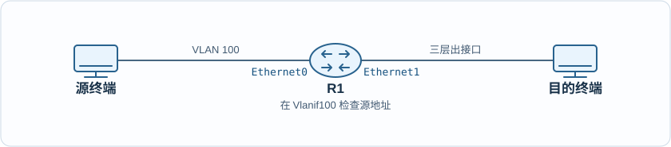

(section-operator-04-ip-routing-urpf-1)=
# uRPF 反向路径检查

<span id="overview"></span>

uRPF 用源地址的路由检查入站流量，适用于限制来源与网络拓扑不符的报文。

<span id="principles"></span>

(section-operator-04-ip-routing-urpf-2)=
## 工作原理

uRPF 用源地址做反向路由查询。宽松模式判断源地址是否可达，严格模式还比较反向出接口和实际入接口。非对称路径可能通过宽松检查而被严格检查丢弃。

严格模式要求源地址的最佳回程走入接口，宽松模式检查源地址在路由表中存在可达路径。

<span id="examples"></span>

(section-operator-04-ip-routing-urpf-3)=
## 配置与验证

(section-operator-04-ip-routing-urpf-4)=
### 拓扑



(case-conditions-04-ip-routing-urpf)=
### 配置条件

直连客户或路径对称时可考虑严格模式。存在非对称路径时先核对回程，再选择宽松模式。

(section-operator-04-ip-routing-urpf-5)=
### 配置步骤

接口可以启用严格或宽松的反向路径检查：

```text
interface Vlanif 100
 ip urpf strict
 ipv6 urpf strict
```

- `strict`：源地址的最佳返回路径必须从收到报文的接口到达；
- `loose`：源地址只需在路由表中可达；
- `disable`或对应的`undo ip urpf`、`undo ipv6 urpf`：关闭该地址族检查。

IPv4和IPv6 uRPF是两个独立配置对象，修改或撤销其中一个不会覆盖另一个。使用 `display urpf` 查看全部地址族，使用`display ipv6 urpf`只查看IPv6接口模式；通过`display ip routing-table ... verbose`或`display ipv6 routing-table ... verbose`检查作为判断依据的路由。

(case-verification-04-ip-routing-urpf)=
### 验证方法

对照以下命令和预期结果核对设备状态。

```vortexros-cli
display urpf
display ipv6 urpf
display ip routing-table
```

核对已启用的接口与模式。分别从符合和不符合回程条件的地址发包，观察允许和丢弃结果。

<span id="observed"></span>

(section-operator-04-ip-routing-urpf-6)=
### 严格模式的实际丢弃计数

GRE 组合测试的 VPP 统计中，IPv4 严格反向检查记录了 4 个 uRPF Drop。合法同流 TCP 继续通过并完成 PAT。宽松模式另验证了只要求源前缀可达的场景。

<span id="precautions"></span>

(section-operator-04-ip-routing-urpf-7)=
## 注意事项

存在非对称路由时，启用严格模式可能丢弃正常业务。先从允许和不允许的源地址做对照。

<p data-legacy-id="id1" class="manual-previous-section" data-section-moved><a href="#overview">介绍</a></p>
<p data-legacy-id="id2" class="manual-previous-section" data-section-moved><a href="#case-conditions-04-ip-routing-urpf">配置准备</a></p>
<p data-legacy-id="id3" class="manual-previous-section" data-section-moved><a href="#examples">配置案例</a></p>
<p data-legacy-id="id4" class="manual-previous-section" data-section-moved><a href="#case-verification-04-ip-routing-urpf">验证配置</a></p>
