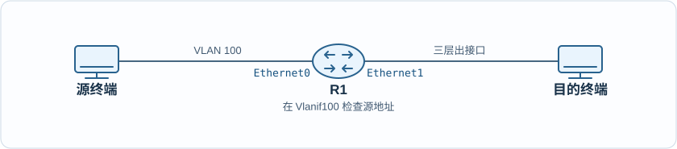

# uRPF 反向路径检查 配置案例

## 拓扑



(case-conditions-04-ip-routing-urpf)=
## 配置条件

直连客户或路径对称时可考虑严格模式。存在非对称路径时先核对回程，再选择宽松模式。

## 配置步骤

接口可以启用严格或宽松的反向路径检查：

```text
interface Vlanif 100
 ip urpf strict
 ipv6 urpf strict
```

- `strict`：源地址的最佳返回路径必须从收到报文的接口到达；
- `loose`：源地址只需在路由表中可达；
- `disable`或对应的`undo ip urpf`、`undo ipv6 urpf`：关闭该地址族检查。

IPv4和IPv6 uRPF是两个独立配置对象，修改或撤销其中一个不会覆盖另一个。使用 `display urpf` 查看全部地址族，使用`display ipv6 urpf`只查看IPv6接口模式；通过`display ip routing-table ... verbose`或`display ipv6 routing-table ... verbose`检查作为判断依据的路由。

(case-verification-04-ip-routing-urpf)=
## 验证方法

对照以下命令和预期结果核对设备状态。

```vortexros-cli
display urpf
display ipv6 urpf
display ip routing-table
```

核对已启用的接口与模式。分别从符合和不符合回程条件的地址发包，观察允许和丢弃结果。
